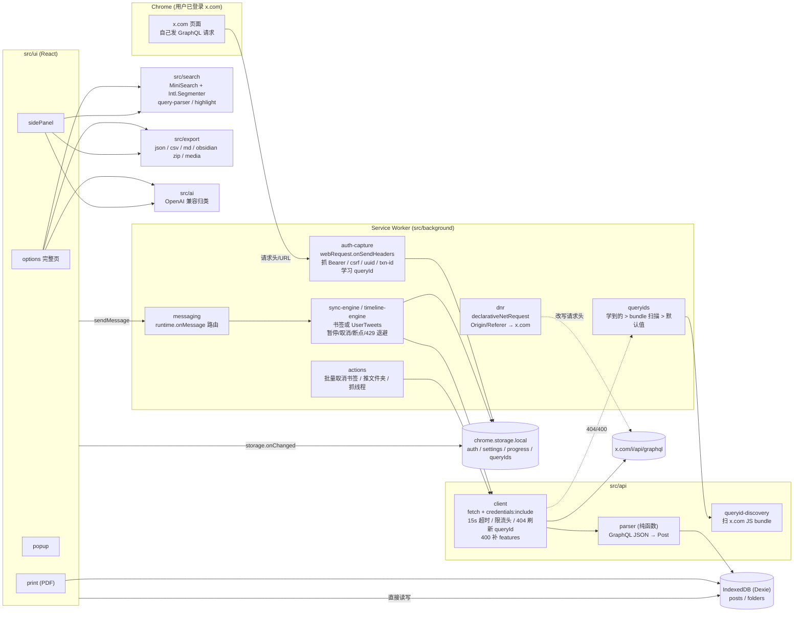

# X Toolkit — X (Twitter) 书签管家 + 打击账本 (Chrome MV3 扩展)

**当前版本: 0.7.18** — 一个扩展同时包含书签库与打击账本 / Strike Ledger。本产品此前名为 Bookmark Keeper；本地书签库 IndexedDB 名仍是 `bookmark-keeper`，旧库可直接升级。0.7.1 给打击账本加上静音/屏蔽队列和限流面板。0.7.2 可以编辑关键词包（含文本导入导出），并从帖子把选中的词加进词库；命中只出黄标，不自动记一笔。0.7.3 在可选 BYOK 建议为垃圾或营销时，经你确认后把抽出的短词写入一个词库；仍然不自动记一笔。0.7.4 在时间线上用保护徽章和标签芯片标出已关注/白名单账号，以及已有的打击次数；点芯片只打开标记，不会自动静音或屏蔽。0.7.5 把「已关注」改成软保护：关键词和黄标仍不会自动入队，但你手动把某个标签记满自己设的阈值后，仍按自动/确认/仅提示静音或屏蔽；白名单仍是硬保护，不会自动入队。0.7.6 把作者级「常营销 / 常垃圾」标到同一份打击账本上，书签库给这个作者已有和以后同步的帖子显示芯片；默认不记一笔，也不静音或屏蔽。0.7.7 在推文详情的回复区单独扫描关键词：默认关闭；打开后默认折叠命中的那一条回复或只提示，不会因评论命中自动静音或屏蔽。0.7.8 在黄色「可疑」和 AI 建议里加上「不像」：本地停用命中的词，或按冷却天数暂时降低它的敏感度；也可以记下一条例外短语（仅该作者，或任何作者）。不会撤销已经确认的记一笔，也不会静音或屏蔽。0.7.9 在折叠条上写出原因：命中的词库词，或已有的「AI 建议垃圾 / 营销」说法。多条命中只留最主要的一条，其余收成 +N。点折叠条展开原文，再点收起。时间线本地折叠和评论区折叠都有这条。选项里可以关掉「折叠条显示原因」，默认开。不改记账阈值、静音/屏蔽、白名单、已关注和误判。0.7.10 增加可选社区名单：导入或订阅一份本地 JSON（或一行一条的文本）后，需要自己打开开关。命中只出黄色「可疑」，或按现有折叠策略折叠，折叠条可写成「社区名单 · 名称」。不记 strike，不入静音/屏蔽队列，点黄标也不记账。白名单仍不折叠，已关注仍不折叠。订阅失败时用上次缓存。不走 GraphQL 拉黑，也不把账本同步到云端。0.7.11 给每一条关键词规则加了「可入队」开关，默认开，和以前一样。关掉某一条之后，它仍然会黄标，该折叠的仍然折叠；只是仅因这条产生的命中不会把账号推进静音或屏蔽队列。其它仍可入队的规则自己记满阈值后，仍按自动、确认或仅提示入队。白名单和已关注的保护不变。社区名单仍然不记账、不入队。0.7.12 给每种标签（垃圾、营销、自定义）加了可选的展示效果：芯片着色、无特殊效果、帖子轻描边、折叠条配色。默认仍是现在的芯片颜色。只改样子，不改记账、入队、保护或社区名单。设置存在本机。0.7.13 在设置页提供一键全量备份：一个本机 JSON 同时带走打击账本、词库、误判、社区名单、静音/屏蔽队列和书签库。API key 和登录会话默认不写入。恢复是整包替换，先看摘要再确认。不上传。0.7.14 在时间线和评论区悬停作者头像或名字时弹出只读浮卡：账本摘要、白名单和已关注（若已知）。可选地用已登录会话只读抽样近约 30 天原创帖的付费合作占比，结果缓存在本机；字段拿不到就显示「暂无法统计」，不编造 0%。浮卡不记账、不入队、不静音、不屏蔽。占比拉取默认关闭。0.7.15 把书签 AI 从「每条一个文件夹」改成内容多标签：选中或未打标签的帖子经预览确认后写入一个或多个主题标签，可在帖子上增删改；列表用标签复选框按「任一」筛选，搜索框里的 `tag:甲 tag:乙` 仍是「同时包含」。提示词中英双语。本机 Ollama（`http://127.0.0.1:11434/v1`）可以不填 key。不改文件夹移动，也不使用打击账本的 key。0.7.16 把设置页「从备份恢复」的文件大小上限提高到 512 MiB。大约 115 MB 的旧 bookmark-keeper JSON 可以通过大小检查。帖子、文件夹和账本的条数上限不变。超过 512 MiB 仍然拒绝，文件不上传。0.7.17 在同步前确认检测到的登录账号，也可手选或手填 @handle；这次同步看到的书签标到这个收藏账号，列表徽章和「收藏账号」筛选会列出它们。全量同步只把这个账号自己没再见到的书签标成已取消，不会动另一个账号仍收藏的帖子。已经误标的，用正确账号再全量同步会恢复为有效并补上账号。0.7.18 在设置页「数据」里、全量备份旁边，可以按一个收藏账号导出书签库子集（含标签、文件夹和笔记），可选带上尚未标记的书签。这份文件用「从备份恢复」会合并进书签库，不整包替换其它账号或打击账本。全量备份仍然是整包，恢复仍然是替换。

在 x.com 时间线上标记垃圾/营销的账本与书签同步共用一个工具栏图标。请卸载单独安装的 X Strike Ledger，否则两个内容脚本会同时注入。

把你在 X 上的**书签**与指定账号的**公开发帖**(UserTweets)同步到本地 IndexedDB，提供中英文全文搜索、文件夹/标签管理、批量操作、导出和可选的 AI 内容标签。

灵感来自 twillot 的书签/时间线思路（只借鉴整体架构与端点名称，**代码全部重新编写**，不含 twillot 的名称/图标/域名，也没有复制其 MPL-2.0 源文件）。不做发推、点赞、关注、授权/付费墙/多账号。

<details>
<summary><strong>English summary</strong></summary>

Chrome MV3 extension **X Toolkit**. It syncs X **bookmarks** and optional public **UserTweets** into local IndexedDB, and adds a local **Strike Ledger**: mark Spam / Marketing on the x.com timeline, then hide locally or (only if you turn it on) mute/block through X’s own menu. v0.7.1 queues mute/block (jitter of about 1s+, a daily cap, backoff, pause/resume). v0.7.2 adds editable keyword packs (including plain-text import/export) and **Add selection to keyword pack** from a tweet’s Mark menu or the right-click menu. A keyword hit still only shows the yellow Suspect chip and never adds a strike. v0.7.3 can distill one BYOK spam/marketing suggestion into short keyword rules after you confirm; that save does not add a strike and does not call the model again. v0.7.4 paints a Protected badge on accounts you follow or whitelist, and compact tag chips such as Spam×2 beside the name and in the strike row. Clicking a chip opens Mark and does not enqueue mute or block. v0.7.5 makes following a soft protect: a keyword hit, the yellow Suspect chip, or an AI suggestion alone still does not auto-queue mute or block, and unknown follow state stays conservative. After you confirm enough strikes to reach your per-tag threshold, mute/block follows the same automatic / confirm / prompt-only mode as any other account. Whitelist stays a hard protect and is never auto-queued. v0.7.6 stores author-level marketing and spam flags on that same ledger (`xsl`, `ledger[userId].authorFlags`). The bookmark library reads them and shows a marketing-prone or spam-prone chip on existing and future posts. Marking an author from the library does not add a strike unless you turn that on, and it never queues mute or block. Search with `author:marketing` or `strike:spam`. The Mark sheet can still queue mute or block for someone you follow. The green badge stays **已关注保护** / **Protected**. v0.7.7 scans replies on a tweet detail page with the same keyword packs. Comment scanning is its own switch and is off by default. A hit paints the yellow Suspect chip and, by default, folds that one reply; you can switch it to prompt only. A comment hit never auto-queues mute or block. Whitelist is not folded. Accounts you follow are not auto-folded and are not auto-queued. Confirming the chip can add a strike. Mute and block still queue only from the Mark sheet, through X's own menu. v0.7.8 adds **Not spam** on the yellow Suspect chip and on an AI suggestion. It locally vetoes the matched keyword, or cools that rule down for the number of days you set (0 means until you undo it). During a cool-down the word alone does not paint the chip; it can still show if another rule that is not cooled down also matches. You can also save an exception phrase for that author or for any author. Confirmed strikes stay. Nothing is muted or blocked. Whitelist stays a hard protect and following stays a soft protect. The list of vetoes is local only. v0.7.9 writes the reason on the collapse bar: the matched keyword, or the existing “AI suggests Spam / Marketing” label. Several hits keep the main one and fold the rest into +N. Click the bar to read the post, and click again to collapse it. Timeline hides and folded replies both get the bar. “Show why on the collapse bar” is on by default. Strikes, mute, block, whitelist, following, and vetoes are unchanged. v0.7.10 adds an optional community list. Import or subscribe to a local JSON file (or one entry per line), then turn the switch on. A hit paints the yellow Suspect chip, or folds under the same protections; the bar can read “List · name”. It does not add a strike, does not enter the mute/block queue, and clicking the chip does not record one either. Whitelist is not folded. Accounts you follow are not folded. A failed refresh keeps the last cached copy. No GraphQL block, and the ledger is not synced to a cloud. v0.7.11 adds a per-rule Can queue switch, on by default. Turning it off does not turn matching off: the yellow chip and folding stay. A hit that comes only from that rule does not enter the mute or block queue. Other rules that can still queue follow automatic / confirm / prompt-only once their own strikes reach the threshold. Whitelist and following protections stay. Community-list hits still never record a strike and never queue. v0.7.12 adds an optional display effect per tag (Spam, Marketing, and custom tags): colored chip, no special effect, a thin card edge, or a collapse-bar accent. The default stays the current chip colors. It changes paint only: strikes, the queue, protection, and community lists stay as they are. The choice is stored on this device. v0.7.13 adds a one-step full backup on the settings page: one local JSON holds the strike ledger, keyword packs, vetoes, community lists, the mute/block queue, and the bookmark library. API keys and the login session are left out unless you opt in. Restore replaces local extension data after a summary, and nothing is uploaded. v0.7.14 adds a read-only hover card on a timeline or reply author (avatar or name): ledger summary, whitelist and following when known, and an optional paid-partnership ratio for original posts from about the last 30 days. The ratio is a signed-in read of UserTweets, cached on this device, and says it cannot be counted when the field is missing instead of inventing 0%. The card does not record a strike, enqueue, mute, or block. The ratio fetch stays off until you turn it on. v0.7.15 changes bookmark AI from one folder per tweet to one or more content tags. You preview, then apply. Tags stay editable on the post. Checked tag boxes match any of them (OR); `tag:a tag:b` in the search box still means all of them (AND). Prompts are bilingual so Chinese bookmarks and Chinese tag names work. Local Ollama (`http://127.0.0.1:11434/v1`) can use an empty or placeholder key. Folder moves are unchanged, and this key is not the Strike Ledger key. v0.7.16 raises the Settings → Restore from backup size ceiling to 512 MiB, so a legacy bookmark-keeper JSON of about 115 MB passes the size gate. Post, folder, and ledger count caps stay. Anything over 512 MiB is still rejected. The file is not uploaded. v0.7.17 asks you to confirm the detected login before a bookmark sync, or pick / type a @handle. Bookmarks seen in that run are stamped with that account, so library badges and the Bookmarked-by filter can list them. A full sync marks unbookmarked only posts that this account no longer has; the other account’s bookmarks stay. A later full sync with the right account turns a mis-marked post active again and adds the stamp. v0.7.18 adds, on Settings → Data beside the full backup, an export of one collector account’s bookmarks (tags, folders, and notes), with an option to include rows that still have no stamp. Restoring that file merges it into the bookmark library and does not replace other accounts or the strike ledger. The full backup is still the whole extension and still replaces on restore. Storage keys stay `bk_*` and `xsl` / `xslSecret`. Unload a standalone Strike Ledger install so the page is not injected twice. Mute and block stay off until you enable them. **Not verified against real X accounts** in this repo; unit tests + Mock-X e2e only. May violate X ToS; use at your own risk. MIT License.

Step-by-step: [docs/USAGE.md](./docs/USAGE.md) · Develop: [docs/DEVELOPMENT.md](./docs/DEVELOPMENT.md) · Contribute: [CONTRIBUTING.md](./CONTRIBUTING.md)

</details>

> ## ⚠️ 重要声明：未对真实 X 账号实测
>
> 开发环境无法登录 X，因此**从未对真实 X 接口、真实账号做过验证**。接口形状、默认 queryId、features 开关均来自公开资料和对 twillot 公开思路的阅读，可能已经过期。
>
> 已做的验证仅限：
>
> 1. 用手工构造的 fixture 做的单元测试（解析器、搜索、导出、同步引擎、HTTP 客户端等，`npm test`）；
> 2. `npm run e2e`：真实 Chrome 加载 `dist/` + **本地 Mock X 服务**（自签名 HTTPS，`--host-resolver-rules` 把 x.com 映射到本机），冒烟验证扩展自身流水线（凭证捕获、queryId 刷新、分页、429 退避、DNR 改写 Origin、UI 搜索等）。这证明「扩展代码按预期工作」，**不证明真实 X 会接受这些请求**。

**文档导航**

| 文档 | 内容 |
| --- | --- |
| [docs/USAGE.md](./docs/USAGE.md) | 逐步使用指南（安装、首次同步、发帖同步、搜索、导出、设置） |
| [docs/DEVELOPMENT.md](./docs/DEVELOPMENT.md) | 开发命令、目录、架构落点、e2e |
| [CONTRIBUTING.md](./CONTRIBUTING.md) | 贡献流程 |
| [LICENSE](./LICENSE) | MIT |

---

## 功能

| 功能 | 状态 |
| --- | --- |
| 全量 / 增量同步、断点续传、进度、暂停 / 继续 / 取消 | ✅ 单测 + Mock e2e |
| 按 @handle / 主页链接同步公开发帖 (UserTweets + cursor 翻页) | ✅ 单测；真实接口未验证 |
| 一键同步「我发过的全部帖子」（会话解析 screen_name → UserTweets） | ✅ 单测；真实接口未验证 |
| 发帖与书签分区（`source: timeline\|bookmark`，文件夹 `timeline:@handle`） | ✅ |
| 全量同步报告（内容分布 + Top 作者；完成后自动弹出，也可在「同步」页打开） | ✅ 单测 |
| X 风格深色/浅色主题（可切换，默认深色；设置页 + 列表工具栏） | ✅ |
| 书签列表页：表格列（#/用户/文件夹/帖子/媒体/浏览/转发/喜欢/回复/时间）、列显示开关与重置 | ✅ |
| 列表页筛选面板（日期快捷范围、最旧优先、文件夹/内容/帖子类型/@用户/可用性、标签复选框「任一」） | ✅ |
| 列表页导出面板（帖子|媒体、全部/已选、CSV/JSON/Markdown/PDF、自定义文件名；走现有 export/batch） | ✅ |
| 列表 Dexie/搜索分页（默认 50 行/页），不整库载入 | ✅ |
| 同步 X 书签文件夹（BookmarkFoldersSlice + BookmarkFolderTimeline） | ✅ 单测 + Mock e2e |
| 本地自建文件夹、重命名、删除、手动移动（可选推送到 X，实验性） | ✅ 本地逻辑已测；**推送到 X 未验证** |
| 保留已删除推文 / 已取消的书签（`status`: `active` / `tweet_deleted` / `unbookmarked`） | ✅ 单测 + e2e |
| 全文搜索（MiniSearch + `Intl.Segmenter('zh')`、前缀/模糊、相关性排序、高亮、分页） | ✅ 单测 + e2e |
| 查询语法 `from: since: until: folder: has:image/video/link/quote tag: is: source: "短语" -排除` | ✅ 单测 |
| 过滤面板（作者/日期/文件夹/媒体/标签/状态）+ 多种排序 | ✅ 手动构造 + e2e 部分 |
| 标签增删改（单条编辑、批量加/去、全局重命名/删除） | ✅ 单测 |
| 批量取消 X 书签（DeleteBookmark，默认二次确认，可选同时删本地） | ✅ Mock e2e；**真实接口未验证** |
| 导出 JSON / CSV（带 BOM）/ Markdown（单文件）/ Obsidian（zip，每条带 frontmatter 的 .md） | ✅ 单测 |
| 分批导出（默认每批 1000，可配置；优先一个总 zip 内含多批文件，每 10 批再拆 zip） | ✅ 单测 |
| PDF：打印友好页 + `window.print()`（另存为 PDF） | ⚠️ 已实现，未做自动化验证 |
| 媒体批量下载（`chrome.downloads`，图片取 `:orig`，视频取较高码率 mp4） | ⚠️ 文件名/URL 生成有单测；实际下载未验证 |
| AI 内容多标签（0.7.15）：OpenAI 兼容 endpoint；按主题打一个或多个标签；预览确认后才写入；可手动增删改；复选框为「或」、`tag:` 查询为「与」；中英提示词；本机 Ollama 可空 key | ✅ 提示词/解析/分批/合并/筛选单测；**未对真实 LLM 实测** |
| 更大的备份恢复（0.7.16）：设置页「从备份恢复」接受最大 512 MiB 的本机 JSON，包括大约 115 MB 的旧 bookmark-keeper 文件。超过上限仍拒绝。条数上限不变。不上传 | ✅ 大小门单测；**没有用真实大备份在真实 X 上验证** |
| 收藏账号标记（0.7.17）：同步前确认检测到的登录账号，或手选 / 手填 @handle。这次同步看到的书签标到该账号，列表徽章和「收藏账号」筛选列出它们。全量同步只取消「这个账号自己没再见到」的书签，不动其他账号。误标的用正确账号再全量同步会恢复 | ✅ 同步与取消标记单测；**没有在真实 X 上验证登录检测** |
| 书签页铺满窗口、可调字号（0.7.17）：选项页不再限 1280px，宽窗口右侧不再留空。设置里的界面字号默认 15（原来是 14），书签、列表、同步和弹窗一起变 | ✅ 字号档位单测；宽窗口布局用无头 Chrome 量过 |
| 按账号导出书签，书签页和列表页一键切换收藏账号（0.7.18）：设置 → 数据可以只导出一个收藏账号的书签库子集（含标签、文件夹和笔记），用「从备份恢复」合并回来。书签页和列表页的搜索栏下有「收藏账号」一排按钮：全部、每个 @handle、未知账号。它和筛选面板里的「收藏账号」是同一个条件，当前结果的导出跟着变。全量备份仍是整包替换 | ✅ 按账号过滤与合并恢复单测；账号切换在无头 Chrome 里点过；**没有在真实 X 上验证** |
| 线程抓取（TweetDetail，同作者自回复链；同步时可选开关，也可对选中项手动抓取） | ✅ 单测 + Mock e2e；真实响应结构未验证 |
| 设置页：主题、同步选项、页间延迟、中/英语言、LLM 配置、备份导入导出、清空数据 | ✅ |
| 侧边栏（sidePanel）+ popup + options 完整页 | ✅ 渲染冒烟 |
| 多账号书签归属（v0.5）：`accounts` 记录收藏者；删除只动当前登录账号；其他账号的帖子跳过 | ✅ 单测 |
| 库视图（v0.6）：侧栏、媒体画廊、按引用原文归组、重复项（不自动删除） | ✅ 归组单测；界面随构建 |
| 打击账本 / Strike Ledger：时间线标记、本地折叠、阈值、关键词黄标、可选 BYOK；静音/屏蔽走 X 菜单且默认关闭 | ✅ 账本纯逻辑单测；**菜单点击未对真实 X 验证** |
| 静音/屏蔽队列（0.7.1）：抖动、每日上限、可识别的限流退避、暂停/继续、失败重试；打击账本页的队列面板 | ✅ 队列纯逻辑单测；**菜单点击未对真实 X 验证** |
| 关键词包（0.7.2）：启用/停用、编辑、文本导入导出；从帖子「标记」或右键把选中词加入词库；可选命中记录。命中只出黄标 | ✅ 词库纯逻辑单测；**右键菜单未对真实 X 验证** |
| AI 建议蒸馏（0.7.3）：垃圾/营销建议可经确认存为短关键词或紧规则，一次写入所选词库。不自动记一笔，不批量请求模型 | ✅ 蒸馏纯逻辑单测；**建议芯片未对真实 X / 真实 LLM 验证** |
| 保护徽章 + 标签芯片（0.7.4）：已关注/白名单在时间线上显示保护徽章；已有标签显示成「垃圾×2」。点芯片打开标记 | ✅ 展示模型单测；**真实时间线注入未验证** |
| 已关注软保护（0.7.5）：关键词/黄标/AI 建议仍不自动入队；你手动记满阈值后按自动/确认/仅提示处理。白名单仍不自动入队。标记面板的排队静音/屏蔽对已关注账号可用 | ✅ 队列策略单测；**真实时间线注入未验证** |
| 书签库作者芯片（0.7.6）：常营销 / 常垃圾写在打击账本 `xsl` 的作者上。次数达到书签芯片阈值，或你在书签/时间线上手动标作者，已有和以后的书签都显示芯片。默认不记一笔、不静音、不屏蔽。搜索 `author:marketing` / `strike:spam` | ✅ 纯逻辑单测；**真实时间线与真实书签同步未验证** |
| 评论区扫描（0.7.7）：推文详情页的回复单独开关。沿用关键词包和黄色「可疑」，可确认记一笔。默认关闭；打开后默认折叠这一条或只提示。评论命中不自动静音/屏蔽。白名单不折叠，已关注不自动折叠也不自动入队。排队仍走标记里的 X 菜单 | ✅ 纯逻辑单测；**真实详情页注入未验证** |
| 误判反馈（0.7.8）：黄标或 AI 建议上点「不像 / Not spam」，本地停用命中的词，或按冷却天数降低敏感度；可选记下例外短语（仅该作者或任何作者）。不撤销已确认的记一笔，不静音、不屏蔽。设置里可查看并撤销。白名单仍是硬保护，已关注仍是软保护 | ✅ 纯逻辑单测；**真实时间线未验证** |
| 折叠条原因（0.7.9）：时间线本地折叠和评论区折叠的条上写出命中的词，或已有的「AI 建议垃圾 / 营销」。多条只留最主要的一条，其余 +N。点条展开，再点收起。选项「折叠条显示原因」默认开。不改记账、静音/屏蔽、白名单、已关注、误判 | ✅ 纯逻辑单测；**真实时间线未验证** |
| 社区名单（0.7.10）：可选。导入或订阅 JSON / 文本名单后自行打开。命中出黄色「可疑」，或按折叠策略折叠，条上可写「社区名单 · 名称」。不记 strike，不入静音/屏蔽队列，点黄标也不记账。白名单不折叠，已关注不折叠。订阅失败用上次缓存 | ✅ 纯逻辑单测；**真实时间线未验证** |
| 单规则入队（0.7.11）：词库里每一条规则有「可入队」，默认开。关掉后仍黄标、仍可折叠，但仅因这条记满的次数不进静音/屏蔽队列。其它可入队规则自己记满后仍按自动/确认/仅提示。白名单、已关注、社区名单不变 | ✅ 纯逻辑单测；**真实时间线未验证** |
| 标签效果（0.7.12）：每种内置或自定义标签可选芯片着色、无特殊效果、帖子轻描边或折叠条配色。默认是现在的芯片颜色。时间线、评论区和书签里的作者芯片读同一份设置。只改展示 | ✅ 纯逻辑单测；**真实时间线未验证** |
| 一键全量备份（0.7.13）：设置页导出一个本机 JSON，含打击账本、词库、误判、社区名单、静音/屏蔽队列和书签库。密钥默认不含。恢复前看摘要，确认后整包替换。不上传 | ✅ 纯逻辑与存储替换单测；**没有在真实 X 上验证** |
| 悬停浮卡（0.7.14）：时间线和评论区悬停头像或名字，看账本摘要、白名单/已关注，以及可选的近约 30 天原创帖付费合作占比。只读 UserTweets，本机缓存。拿不到字段就写「暂无法统计」。不记账、不入队、不静音、不屏蔽 | ✅ 抽样与浮卡文案单测；**没有在真实 X 上验证** |

---

## 安装

### 方式一：从源码构建

```bash
git clone <仓库 URL>   # 由维护者提供
cd bookmark-keeper
npm install
npm run build          # 类型检查 + 构建到 dist/
npm test               # 建议先跑通单元测试
```

1. 打开 `chrome://extensions`，开启右上角「开发者模式」；
2. 点击「加载已解压的扩展程序」，选择本项目的 **`dist/`** 目录（不是仓库根目录）；
3. 按下一节完成首次使用。

源码仓默认**不提交** `dist/`（见 `.gitignore`）。日常开发可用 `npm run dev`（`vite build --watch`），改完在扩展页点「重新加载」。

### 方式二：直接加载发布包中的 `dist/`

若你通过 **GitHub Releases**（或作者提供的 `bookmark-keeper.zip`）获得构建产物：

1. 解压 zip，确认内含 `dist/manifest.json`；
2. 同样在开发者模式下「加载已解压的扩展程序」→ 选择其中的 **`dist/`**。

### Releases 思路（维护者）

- **Git 仓库**：只提交源码与文档，忽略 `node_modules/`、`dist/`、`*.zip`、`.env*`。
- **GitHub Releases**：打 tag（如 `v0.2.0`）时附带 zip，内含源码 + 已构建的 `dist/`（仍排除 `node_modules`），方便用户免 Node 环境加载。
- 本仓库可用 `zip` 脚本或 CI 生成该产物；本地亦可参考文末「打包」说明。

可选：`npm run e2e` 需要本机 Chrome（`CHROME_BIN` 可指定路径）和 `openssl`，会启动本地 Mock X 做冒烟测试。

---

## 打击账本 / Strike Ledger

安装这一个扩展即可。如果还加载着独立的 X Strike Ledger，先在 `chrome://extensions` 里移除或停用它，避免同一条帖子出现两套「标记」按钮。

打开 x.com / twitter.com / mobile.x.com 的时间线，每条帖子下方有 **标记**（Shadow DOM）。计数只在你确认之后增加；关键词和 AI 只会给黄标，不会自己记账。数据在 `chrome.storage.local` 的 `xsl`，API key 在单独的 `xslSecret`，不会写进书签 IndexedDB，也和书签设置里的 LLM key 分开。

选项页侧栏 **打击账本** 可以改阈值、确认/自动/仅提示、快捷键、关键词包、导入导出。Popup 只有一个，里面有进入账本设置的入口。

静音和屏蔽 **默认关闭**。打开「允许通过 X 的菜单执行静音/屏蔽」后，扩展会去点帖子上 X 自己的「更多」菜单再点 Mute/Block。这是在替你操作网页，不是官方 API，也 **没有** 接到本扩展的 GraphQL DeleteBookmark / 凭证捕获路径。页面改版可能点不到；失败会留在队列里重试。不要用自动模式配合屏蔽做批量封禁。本地折叠不访问 X。

### 在时间线上试静音/屏蔽队列

达到阈值，或你在「标记」面板里点「排队静音 / 排队屏蔽」时，动作只进入本地队列，不会在页面上连点。打开的时间线每次只处理一条能看见的账号：间隔不少于设置值，再加约 1–2.5 秒抖动；有每日上限；若页面上出现能识别的限流提示（例如 429）会退避。选项页 **打击账本 → 队列与限流** 显示队列长度、失败项、最近错误、今日已用/上限，并可暂停、继续、重试失败项、清空等待或失败项。

自动 / 确认 / 仅提示仍然有效。**白名单是硬保护**：不会自动入队静音或屏蔽。**已关注是软保护**：关键词命中、黄色「可疑」和单独的 AI 建议不会自动入队；关注状态未知时也不会自动静音或屏蔽。你自己把某个标签记到该标签的阈值（例如垃圾 ×3，或你在选项里改过的次数）之后，已关注账号和未关注账号走同一套模式：自动则入队，确认则弹出勾选，仅提示只出通知。标记面板里的「排队静音 / 排队屏蔽」对已关注账号可用。仍只点 X 自己的菜单。静音和屏蔽默认关闭。

1. 重新构建并加载 `dist/`。选项页打开「允许通过 X 的菜单执行静音/屏蔽」，每日上限可先设小（例如 3）。模式用 **确认** 更稳妥。
2. 打开 x.com 时间线，点「标记」→「排队静音」。已关注账号也可以这样排队。也可以把垃圾标记到阈值，在确认框里勾选静音或屏蔽。白名单账号不会因为记满阈值而自动入队。
3. 留在能看到该账号帖子的时间线。扩展会按队列去点 X 的「更多」菜单，而不是把队列一次点完。
4. 回到 **队列与限流** 看长度、失败和今日用量。可暂停后再继续。失败项可以单条或整批重试。

书签同步里的 “timeline” 是 UserTweets 抓取；打击账本里的时间线是页面上的标记/折叠。两套消息类型分开（书签是 `timeline/start` 这类，账本是 `MARK` / `SET_HIDDEN` 这类）。

### 从一条帖子把词加入关键词包（0.7.2）

关键词命中**只**在帖子上显示黄色 **Suspect / 可疑**。它不会给账号加打击次数。要记账，仍需你在「标记」里自己确认。

**用「标记」菜单（推荐）：**

1. 重新构建并加载 `dist/`（版本 0.7.2）。
2. 打开 x.com 时间线，在某条帖子正文里用鼠标选中一个词或短语。
3. 点这条帖子上的 **标记**。
4. 面板下方会带上选中的文字。选一个关键词包，点 **加入此包**。没选中文字时，也可以在同一个输入框里自己打一个词。
5. 这个词按「正文」保存（不会当成正则）。之后别的帖子正文再出现它，才会出黄标。重复添加会提示已经在包里。

**用右键（Chrome MV3 的 contextMenus，仅在 x.com / twitter.com 的选中文字上出现）：**

1. 选中帖子里的文字，右键。这依赖 manifest 里的 `contextMenus` 权限；重新加载扩展后即可使用。
2. 选 **把选中文字加入关键词包**（英文界面是 **Add selection to keyword pack**）。
3. 再选要放进的词库。停用的包会标成「已停用」，仍可以加入，但停用期间不会出黄标。

选项页 **打击账本 → 关键词包** 可以启用/停用每个包、改名称和建议标签、逐条改规则。下面的 **词库文本** 用纯文本编辑整套词库：`[包名]` 开头，接着可选 `id:` / `enabled:` / `suggest:`，然后每行一条。没有 `[包名]` 的纯词表会导入成一个名为 `Imported` 的包。点 **应用文本** 只更新表单，再点 **保存** 才写入。**导出文本** / **导入文本** 走 `.txt`。

**命中记录**默认关闭。打开「记录关键词命中（调试）」后，黄标会在本机留下最多 40 条短记录（词、包、账号、摘要），便于看规则为什么响。可以清空。这条记录**不会**增加打击次数。

### 把一条 AI 建议蒸馏进关键词包（0.7.3）

AI 建议默认关闭。密钥仍只在 `xslSecret`，不进词库，也不进书签库的 LLM 设置。蒸馏不会自己记一笔，也不会把时间线上的帖子批量发给模型。

1. 重新构建并加载 `dist/`（版本 0.7.3）。选项页 **打击账本 → AI 建议** 打开「启用 BYOK 建议」，填写端点、模型和 API key，然后保存。不打开时，时间线上没有「让 AI 看一看」。
2. 打开 x.com 上的一条帖子。点 **让 AI 看一看**。同一条帖子的正文、简介和用户名会先按内容哈希查本地缓存；命中缓存就不会再请求。自动询问只在你另外打开「只对黄标可疑帖自动询问」时，对已经是黄标的那一条生效，仍然一条一条来。
3. 若芯片变成 **AI 建议垃圾** 或 **AI 建议营销**，点它。面板列出从这条建议抽出的短规则：模型原文里出现、并且帖子里确实有的短语；原因里用引号标出、并且帖子里有的片段；短链、`微信:` 一类联系方式、`日入`+金额、`dm me` 这类紧规则。没有抽出短词时，面板不显示保存按钮。
4. 选一个关键词包（会优先选已启用、且建议标签与这次判断一致的包）。点 **存为关键词**。勾选的规则一次写入该包。这一下**不**记打击。
5. **确认记一笔** 仍是旁边单独的按钮。只有点它才会给这个账号加一次垃圾或营销。保存关键词不会顺手点它。
6. 之后别的帖子若命中这些词，只出黄色 **可疑**。要记账，仍需你自己确认。

「认为不像」的结果没有可保存的规则。关掉 AI 或清掉 key 之后，不会再发起新的建议请求。

### 时间线上的保护徽章和标签芯片（0.7.4）

0.7.4 把已关注和白名单都画成绿色保护徽章，当时两条路都不自动静音或屏蔽，并把这个账号已经有的标签次数直接显示出来，不用先点「标记」。0.7.5 把「已关注」改成软保护，见下一节。

一条普通帖子在 x.com 时间线上大致是这样（英文界面把「已关注保护」写成 **Protected**，白名单同样是 **Protected**）：

```text
显示名
@handle · 时间
[已关注保护]  [垃圾×2]  [营销×1]
正文……
[标记]  [已关注保护]  [垃圾×2]  [营销×1]  [可疑]
```

- **名字下方一行**（Shadow DOM，插在 X 的用户名区块后面，不塞进会被截断的名字链接里）：绿色徽章。你正在关注时是 **已关注保护**；只有白名单、页面上又能看出未关注时是 **白名单保护**。两者都有时仍显示 **已关注保护**。悬停时，已关注说明「不会因关键词/黄标自动入队；你手动记满阈值后仍可静音或屏蔽」；白名单仍说明「不会自动入队」。同一行接着紧凑芯片，例如 **垃圾×2**、**营销×1**。内置标签在前，其余按次数从高到低，最多 4 个，多出来的是 **+N**。
- **帖子动作栏**（原来的「标记」那一行，同样是 Shadow DOM）：先是 **标记**，然后同一枚保护徽章和同样的芯片，再是原来的黄标 **可疑** 和 AI 芯片。折叠后的占位条也会带上徽章和 `垃圾×2` 这种计数。
- **点芯片**会打开原来的标记面板，不会记一笔，也不会把静音/屏蔽放进队列。保护徽章本身不是按钮。面板顶部用绿色字重复徽章的悬停说明：已关注不再写成「永远不能入队」；白名单仍是「不会自动入队」。关注状态以页面上这次看到的为准；看不到关注按钮、又不在白名单时，不显示保护徽章（自动静音本来也会跳过未知状态）。
- 时间线重绘把注入节点拿掉时，扫描会把 Shadow host 挂回去。挂不上用户名区块时，动作栏里仍然有徽章和芯片。

重新构建并加载 `dist/`（版本 0.7.4）后，打开 x.com 时间线即可看到。这条注入**没有**在真实 X 账号上验证过。0.7.5 起，已关注徽章的含义见下一节；白名单徽章仍然表示不会自动入队。

### 已关注是软保护，白名单仍是硬保护（0.7.5）

0.7.4 把「你正在关注」和白名单都画成绿色保护徽章，并且两条路都不让静音/屏蔽自动入队。已关注挡得太死：你关注的账号仍可能刷屏。0.7.5 把两者拆开。

- **已关注（软保护）**。绿色徽章仍是 **已关注保护**（英文 **Protected**）。关键词命中、黄色 **可疑**、以及没有经你确认的 AI 建议，都不会把静音或屏蔽放进队列。关注状态在页面上看不出来时，仍然保守：不会自动静音或屏蔽。
- **你自己记满阈值**。在「标记」里确认垃圾/营销（或快捷键、或对黄标/AI 点「确认记一笔」）直到该标签的阈值，例如默认垃圾 ×3，或你在选项里为这个标签改过的次数。记满之后，和未关注账号一样走当前模式：**自动**则入队静音/屏蔽（需已打开对应开关），**确认**则弹出勾选，**仅提示**只出通知、不入队。本地折叠仍不因「已关注」在自动模式下打开。
- **标记面板上的「排队静音 / 排队屏蔽」**对已关注账号可用。这一下是你明确要求入队，不看关键词，也不看有没有记满阈值。
- **白名单（硬保护）**。徽章文案仍可写成「不会自动入队」。记满阈值也不会自动入队静音或屏蔽。已关注并且在白名单里时，徽章仍显示 **已关注保护**，悬停会说明白名单不会自动入队。

静音和屏蔽仍默认关闭，仍只点 X 自己的菜单，不走 GraphQL。重新构建并加载 `dist/`（版本 0.7.5）。这条策略有单测；**没有**在真实 X 账号上验证过。

### 书签库里的常营销 / 常垃圾（0.7.6）

作者标记只有一份，放在打击账本里：`chrome.storage.local` 的 `xsl`，字段是 `ledger[用户 id].authorFlags`（`marketing` / `spam`）。公开索引 `xsl.index` 带上同一份标记和标签次数，书签库读它。没有第二份 `bk_*`，也没有单独的 Dexie 作者表。

- **已有和以后的书签**。某个作者的营销或垃圾次数达到「书签芯片阈值」（默认 3，和静音/屏蔽阈值分开），或者你明确标过这个作者，列表、卡片、媒体画廊都会显示 **常营销** 或 **常垃圾**（英文 **Marketing-prone** / **Spam-prone**）。书签不会被删。
- **在书签里标作者**。每条帖子和批量栏都可以「标为常营销 / 取消常营销」，垃圾同理。标的是作者：同一个人的多条书签只写一次。之后同步进来的帖子也会带上芯片。
- **默认保守**。设置里「在书签里标作者时，同时给账本记一笔」默认关闭。关掉时只显示芯片，不增加打击次数，也不进入静音/屏蔽队列。打开后，每个作者最多用一条书签作为依据记一笔，仍然不会自动静音或屏蔽。
- **时间线**。你在「标记」里把垃圾或营销记到书签芯片阈值以上时，书签库会读到这枚芯片。标记面板另有「同时在书签库标出这个作者」：没到次数也可以先标上。这一下不入队。
- **搜索**。`author:marketing`、`author:常营销`、`strike:spam`、`strike:any`，以及前面加 `-` 排除。列表筛选里也可以选作者标记。
- **保护不变**。白名单仍不会自动入队。已关注仍是软保护：关键词和黄标不自动入队；你在时间线上手动记满静音/屏蔽阈值后，仍按原来的自动/确认/仅提示。单靠这枚书签芯片不会静音或屏蔽。

同一组开关在 **设置** 页的「书签与打击账本」，以及 **打击账本** 页的「书签库联动」。两边写的都是 `xsl.settings`。

重新构建并加载 `dist/`（版本 0.7.6）。这条联动有单测；**没有**在真实 X 账号上验证过。

### 评论区扫描（0.7.7）

时间线上的关键词预标不动。推文详情页（`/{handle}/status/{id}`，以及 `/i/status/`、`/i/web/status/` 和图片/视频查看）里，主帖仍走时间线规则；其余 `article[data-testid="tweet"]` 回复只有在单独打开「扫描评论区回复」后才做关键词扫描。内容脚本本来就会注入这些页面，不新增 GraphQL。

- **默认关闭**。选项页 **打击账本 → 评论区** 打开后才扫描回复。和时间线的「启用关键词预标」分开：只开时间线时，回复不出黄标、也不折叠；只开评论区时，时间线不预标。
- **黄色「可疑」**。命中的是现有关键词包。点黄标可以确认记一笔。不点就不记。
- **默认折叠这一条**。只藏这一条回复，不把整个账号标成隐藏，不静音，不屏蔽。占位条上可以「显示这条」，或再点黄标确认记一笔。改成「只出黄标，等你确认」则不折叠。
- **不自动入队**。评论里的关键词、黄标、以及从黄标或 AI 芯片确认的那一笔记账，都不会把静音或屏蔽放进队列。关注状态未知同样不会自动静音或屏蔽。要入队，仍在「标记」里点「排队静音 / 排队屏蔽」，由打开的时间线去点 X 自己的菜单。
- **保护**。白名单是硬保护：不折叠。已关注是软保护：不自动折叠，也不自动入队；黄标还在，你可以确认记一笔。AI 建议仍只在你本来就打开 BYOK 时出现，自动询问也只对已经是黄标的回复、并且你打开了那个开关时才会问。

重新构建并加载 `dist/`（版本 0.7.7）。这条策略有单测；**没有**在真实 X 账号上验证过。

### 误判反馈（0.7.8）

黄色「可疑」和 AI 建议芯片上有 **不像**（英文 **Not spam**）。点开后先列出将要停用的命中，确认后才写入本机。

- **停用命中的词**。确认之后，这些词不再单独把帖子标黄。词还在关键词包里，只是这台浏览器不再用它单独标黄。已经确认的记一笔不会被撤掉。
- **冷却天数**。选项页 **打击账本 → 误判与冷却**。默认 14 天。大于 0 时，到期后这个词恢复；冷却期内如果另一条没被停用的规则也命中，仍会标黄。填 0 则一直停用，直到你撤销。
- **例外短语（可选）**。确认框里可以勾选从这条帖子抽出的短语。默认只对这个作者生效，也可以改成任何作者。含有该短语时，上面那些词不再标黄。例外不跟着冷却到期，要在同一列表里撤销。
- **AI 建议**。点「不像」不会把抽出的词写进词库。若这些词已经在词库里，或以后再加进词库，也会按上面的冷却停用。这一下不记一笔，也不再请求模型。
- **不会自动处理**。不静音、不屏蔽、不入队。白名单仍是硬保护。已关注仍是软保护：关键词和黄标不自动入队；你手动记满阈值后，仍按原来的自动 / 确认 / 仅提示。

**Not spam** sits on the yellow Suspect chip and on an AI suggestion. The sheet lists the hits that will be turned off before anything is saved. Confirmed strikes stay. Nothing is muted or blocked. Cool-down days live under Strike Ledger → False positives (default 14; 0 means until undo). During a cool-down the word alone does not paint the chip, but another rule that is not cooled down still can. An optional exception phrase is local, for that author or any author, and lasts until you undo that row. Whitelist stays a hard protect. Following stays a soft protect.

重新构建并加载 `dist/`（版本 0.7.8）。这条策略有单测；**没有**在真实 X 账号上验证过。

### 折叠条上的原因（0.7.9）

帖子或回复被折起来时，折叠条上会写明为什么，并且尽量短：

- **词库词或规则**。例如 `词库 · 空投`。好几条一起命中时，只留最主要的一条（未冷却、可读的关键词优先于长正则；垃圾优先于营销），其余收成 `+N`，例如 `词库 · 空投 +2`。正则太长、放上去会占满一行时，收成 `词库 +N`。
- **AI 建议**。没有词库命中、但这条已经有垃圾或营销建议时，用原来的说法，例如 **AI 建议垃圾**（英文 **AI suggests Spam**）。词库和 AI 同时有时，AI 算进 `+N`，悬停可以看到全文。
- **时间线上的本地折叠**。账号已被折叠、这条帖子本身又没有词库或 AI 命中时，用已有的标签芯片文案，例如 `垃圾×3`。评论区折叠的是这一条回复，原因来自关键词命中。
- **展开**。点折叠条（或「展开这条」）看原文，再点同一条（或「收起」）收回。黄标、取消折叠这些按钮仍是原来的动作。
- **开关**。选项页 **打击账本 → 评论区** 里的「折叠条显示原因」默认打开。关掉后仍然折叠，只是不写原因，恢复原来的短说明。

不改记账阈值，不改静音/屏蔽队列，不改白名单硬保护和已关注软保护，不改误判 veto，也不走 GraphQL 拉黑。

重新构建并加载 `dist/`（版本 0.7.9）。这条展示有单测；**没有**在真实 X 账号上验证过。

发布包 `x-toolkit-0.7.9-chrome.zip` 的根目录就是可「加载已解压的扩展程序」的文件夹，内含 `manifest.json`（版本 0.7.9）。本地重新打包：`npm run build`，再把 `dist/` 里的文件（不要多套一层 `dist/` 目录）打成 zip。源码仓不提交这个 zip。

### 可选社区名单（0.7.10）

社区名单是可选的，默认关闭。它只影响黄色「可疑」和本地折叠，**不会**自动记一笔，**不会**进入静音/屏蔽队列，点黄标也**不**记账。不调用 X 的 GraphQL，也不把账本同步到云端。

1. 重新构建并加载 `dist/`（版本 0.7.10）。选项页 **打击账本 → 社区名单**。
2. 导入一份 JSON，或粘贴一行一条的文本，或填一个 https 名单地址再订阅。导入和订阅只写在本机，**不会**把「启用社区名单」打开。
3. 勾选 **启用社区名单**。命中后默认 **仅黄标**。若改成 **可折叠**，会按现有折叠策略收起这条时间线帖子或回复：白名单不折叠，已关注不折叠，你正在看的那条主帖不折叠。关注状态未知时可以折叠，仍然不静音、不屏蔽、不记账。
4. 点页面上的 **保存**。之后回到 x.com。命中时出现黄色 **可疑**。折叠条在「折叠条显示原因」打开时写成 `社区名单 · 示例名单`，多条收成 `+N`。点黄标只说明名单名称，可以点「不像」停用这次命中；没有「记一笔」。
5. 订阅可以 **刷新** 或 **删除**。刷新失败时卡片上会写错误，并继续用上次成功拉到的缓存。每份名单大约可放 1500 个账号和 1500 个词，最多 6 份。
6. 白名单仍是硬保护，已关注仍是软保护，误判 veto 仍然生效：已经停用的词，社区名单里的同一个词也不会再单独标黄。

稳定格式是这份 JSON（`version` 目前为 1；匹配是原文包含，不是正则）：

```json
{
  "format": "x-toolkit-community-list",
  "version": 1,
  "name": "示例名单",
  "handles": ["spam_bot"],
  "keywords": ["加群领资料", "日入"]
}
```

同一份数据也可以写成文本，便于粘贴：

```text
# name: 示例名单
@spam_bot
加群领资料
日入
```

`@` 开头是账号（精确匹配，不区分大小写）。其它非空行是词，出现在正文、简介或显示名里即命中。`#` 开头是注释，`# name:` 写名单名称。也接受 JSON 字符串数组：`@` 开头是账号，其余是词。URL 要返回上面任一种内容，并且是 https（本机可以用 `http://localhost` 或 `http://127.0.0.1`）。

重新构建并加载 `dist/`（版本 0.7.10）。这条逻辑有单测；**没有**在真实 X 账号上验证过。

发布包 `x-toolkit-0.7.10-chrome.zip` 的根目录就是可「加载已解压的扩展程序」的文件夹，内含 `manifest.json`（版本 0.7.10）。源码仓不提交这个 zip。

### 单规则入队开关（0.7.11）

每一条关键词规则默认「可入队」。记满阈值后，静音和屏蔽仍由全局的自动 / 确认 / 仅提示，以及白名单、已关注决定。关掉某一条的「可入队」**不是**关掉匹配：黄标还在，评论区该折叠的仍然折叠。只是仅因这条规则确认下来的记一笔，不计入静音/屏蔽的次数，也不会把账号推进队列。同一条帖子上若还有别的「可入队」规则命中，这些可入队的记一笔自己凑满阈值后，仍按原来的方式入队。

1. 重新构建并加载 `dist/`（版本 0.7.11）。选项页 **打击账本 → 规则**，打开某个关键词包。
2. 每一行规则旁边有 **可入队**。取消勾选只影响这一条。**本包可入队**一次改这个包里的每一条。改完点 **保存**。也可以在词库文本里写 `enqueue: false`（整包）或在行尾写 `{enqueue:false}`。
3. 时间线上，关掉入队的词仍然出黄色「可疑」。点黄标确认记一笔后，次数会增加，本地折叠仍按原来的隐藏开关。静音和屏蔽要等其它仍可入队的规则（或你在标记里亲手记的笔）自己记满阈值。
4. 社区名单命中仍然不记账、不入队。白名单仍不会自动入队。已关注仍是软保护。不走 GraphQL 拉黑，也不把账本同步到云端。

这条逻辑有单测；**没有**在真实 X 账号上验证过。

发布包 `x-toolkit-0.7.11-chrome.zip` 的根目录就是可「加载已解压的扩展程序」的文件夹，内含 `manifest.json`（版本 0.7.11）。源码仓不提交这个 zip。

### 标签效果（0.7.12）

每种标签可以单独选一种看起来的效果。垃圾、营销和你自己加的标签都在里面。默认是 **芯片着色**，和现在一样。这一项只改展示，不改记账次数、静音/屏蔽队列、白名单、已关注或社区名单。设置写在本机的打击账本里。

1. 重新构建并加载 `dist/`（版本 0.7.12）。选项页 **打击账本 → 阈值**，找到 **标签效果**。
2. 每种标签一个下拉框：**芯片着色（默认）**、**无特殊效果**、**帖子轻描边**、**折叠条配色**。改完点 **保存**。
3. **芯片着色**保留现在的颜色：垃圾偏红，营销偏蓝，自定义标签是浅色。时间线上名字旁边和「标记」那一行、评论区、书签里的「常垃圾 / 常营销」用的是同一份选择。
4. **无特殊效果**把这种标签的芯片改成中性样式，不加描边，折叠条仍是原来的橙色。
5. **帖子轻描边**在芯片颜色之外，给这条帖子左侧加一条细边。时间线、评论和书签卡片都有。同一条上如果好几种标签都选了描边，垃圾优先，然后是营销，再是自定义。
6. **折叠条配色**在芯片颜色之外，把时间线或评论的折叠条改成这个标签的颜色。颜色跟着折叠条上的原因走（命中的词对应的标签，或已有的垃圾×2）。社区名单的折叠条不跟着标签变色。书签没有折叠条，芯片仍保持着色，方便认出。
7. 点芯片仍然只打开标记。不会因为换了效果就记一笔、入队、静音或屏蔽。

这条展示有单测；**没有**在真实 X 账号上验证过。

发布包 `x-toolkit-0.7.12-chrome.zip` 的根目录就是可「加载已解压的扩展程序」的文件夹，内含 `manifest.json`（版本 0.7.12）。源码仓不提交这个 zip。

### 一键全量备份（0.7.13）

换机或留一份本机副本时，用这一个入口。文件是 JSON，带 `format: "x-toolkit-full"` 和 `version: 1`，方便以后识别。扩展不会上传，也没有云同步。

1. 重新构建并加载 `dist/`（版本 0.7.13）。打开选项页 **设置**，找到 **一键全量备份**。
2. **一键导出全量备份** 会下载 `x-toolkit-full-backup-日期.json`。默认**不**包含打击账本的 AI key、书签归类的 API key，以及本机记住的 X 登录凭证。需要把这些一起带走时，先勾选 **备份中包含 API key 和登录会话**。
3. 文件里有：打击账本设置和账本（含作者「常营销 / 常垃圾」）、词库和规则、误判、社区名单缓存和订阅地址、静音/屏蔽队列和本地隐藏、书签帖子与文件夹（含标签、账号归属、笔记）、书签设置、多账号记录、已学习的 queryId。搜索索引不放进文件，恢复后按新库重建。
4. **从备份恢复** 先显示摘要（格式、版本、条数）。确认后是**整包替换**，不是合并：本机多出来的书签和账本会被这份文件覆盖。没有放进文件的密钥会留在这台浏览器；勾选过密钥时，文件里的空 key 会清掉本机对应的密钥。正在进行的同步进度会被清掉。
5. 以前设置页单独的「导出备份」已并进这里。旧的 `bookmark-keeper` JSON 仍可选：摘要会写明它**只替换书签库**，不动打击账本。打击账本页「数据」里原来的导出仍是**单独的账本 JSON**，不含书签库；那种文件请仍在那里导入。
6. 列表里的 JSON / CSV / Markdown 是帖子摘出，不能用来恢复扩展。

这条备份有单测；**没有**在真实 X 账号上验证过。恢复不会替你发静音或屏蔽。

发布包 `x-toolkit-0.7.13-chrome.zip` 的根目录就是可「加载已解压的扩展程序」的文件夹，内含 `manifest.json`（版本 0.7.13）。源码仓不提交这个 zip。

### 悬停浮卡（0.7.14）

在时间线或推文详情的回复上，鼠标停在作者头像或名字上，会弹出一张只读摘要。它不记账、不入队、不静音、不屏蔽。

1. 重新构建并加载 `dist/`（版本 0.7.14）。默认就会出浮卡。选项页 **打击账本 → 规则**，找到 **悬停浮卡**。取消「悬停头像或名字时显示摘要」后，浮卡不再出现。
2. 浮卡上有：`@用户名`、账本里的垃圾/营销次数（没有就写还没有记录）、常垃圾 / 常营销（和书签芯片用同一套规则，达到阈值或你标过作者才出现）、已关注或白名单（页面或账本里知道的时候；不知道就写未知）。
3. **付费合作占比默认关闭**，避免悬停就打 UserTweets，也避免和书签/发帖同步抢同一条限流。要看占比时，勾选「拉取近约 30 天原创帖的付费合作占比」并保存。
4. 打开之后，扩展用当前已登录的 X 会话，只读请求 `UserByScreenName`（把用户名换成数字 id）和 `UserTweets`（最多约 3 页、每页 40 条，页与页之间留一点间隔，并且每小时最多抽样 8 个账号）。只数大约 30 天内、这个账号自己发的原创帖，不含转帖和回复。
5. 付费合作优先认响应里的权威字段：`disclosure_type`、`disclosure`、`paid_partnership`，以及旧的 `ext.disclosureType`。值像 `PaidPartnership` 算合作；`null` 或 `NoDisclosure` 算不是。这些字段在同一份响应里出现过时，才给出百分比，包括诚实的 0%。
6. 若响应里没有这些字段，但帖子载荷上有单独的「Paid partnership」或「付费合作」标记，会给出比例并标明可能不完整。若连标记也没有，正文开头恰好是这些字样时，只显示「正文启发式，不确定」。都没有时显示「暂无法统计」，**不会把缺少字段写成 0%**。
7. 你正悬停的这一条如果页面上看得见官方「付费合作 / Paid partnership」字样，浮卡会单独写「本条可见」，这一行不计入 30 天占比。
8. 结果按账号和当天日期缓存在本机的 `xslHoverCache`，大约 12 小时内不重复请求。缓存不进打击账本，也不进全量备份。浮卡底部写明只读。

这条统计有单测；**没有**在真实 X 账号上验证过 UserTweets 是否仍返回付费合作字段。接口若改版，浮卡会停在「暂无法统计」，而不是猜一个比例。

发布包 `x-toolkit-0.7.15-chrome.zip` 的根目录就是可「加载已解压的扩展程序」的文件夹，内含 `manifest.json`（版本 0.7.15）。源码仓不提交这个 zip。

### 更大的备份恢复（0.7.16）

设置页 **从备份恢复** 可以读入更大的本机 JSON。文件字节数和正文长度共用一个上限：**512 MiB**。大约 115 MB 的旧 `bookmark-keeper` 备份可以通过大小检查。超过 512 MiB 会在解析前拒绝。帖子 20 万条、文件夹 5 千个、账本 2 万条的上限没有改。文件仍只在本机，不上传。

1. 重新构建并加载 `dist/`（版本 0.7.16）。选项页 **设置**，点 **从备份恢复**。
2. 选中旧的书签库 JSON 或全量备份。大小在 512 MiB 以内时先显示摘要，确认后才写入。大文件会暂时多占一些浏览器内存。
3. 旧的 `bookmark-keeper` 文件仍然只替换书签库，不动打击账本。

这条大小判断有单测。**没有**用一份真实的一百多 MB 备份在真实 X 账号上验证过导入结果。

发布包 `x-toolkit-0.7.16-chrome.zip` 的根目录就是可「加载已解压的扩展程序」的文件夹，内含 `manifest.json`（版本 0.7.16）。源码仓不提交这个 zip。

### 收藏账号标记（0.7.17）

两个 X 账号共用一个书签库时，每条书签要记住是哪个号收藏的（`post.accounts`，小写用户名）。0.7.17 起，同步页在开始前显示**检测到的当前登录**，也可以从已有账号里选，或自己输入 `@handle`。这次全量或增量同步**看到的书签**都会标成这个账号。标上之后，列表里的 `👤 @handle` 徽章和筛选里的「收藏账号」才会出现。

全量同步结束时的「已取消书签」只针对**这次这个账号**自己没再见到、并且已经标了这个账号的帖子。另一个账号仍收藏的、或还没有账号标记的旧数据，不会被一起标成已取消。登录检测失败、又没有手填账号时，也不再整库误标。

已经被误标成已取消的帖子，用正确账号再做一次全量同步：这次又见到的会变回有效，并补上该账号。

1. 重新构建并加载 `dist/`（版本 0.7.17）。打开 x.com 并刷新一次书签页。
2. 扩展「同步」页确认「本次收藏账号」。检测到的登录显示在输入框下方；不对就改掉或点「改用检测结果」。
3. 用账号 A 做一次全量同步，换到账号 B 再做一次。列表徽章和「收藏账号」应同时有 A 和 B。
4. 只再同步 A 时，只有 B 收藏的帖子仍是有效书签。

登录检测先请求 `account/settings.json`，失败再试 `verify_credentials.json`；仍失败时读已打开的 x.com 页个人资料链接。这条**没有**在真实 X 账号上验证过。

同一版里，选项页的书签区改成铺满窗口：以前整页限在 1280px，宽窗口右侧会空出一条。侧栏还在，右边的书签卡片和列表跟着变宽。设置里可以调「界面字号」（13–20，默认 15）。书签、列表、同步、设置、打击账本和弹窗一起变。14 是原来的大小。

发布包 `x-toolkit-0.7.17-chrome.zip` 的根目录就是可「加载已解压的扩展程序」的文件夹，内含 `manifest.json`（版本 0.7.17）。源码仓不提交这个 zip。

### 按账号导出书签（0.7.18）

几个 X 账号的书签同步进同一个库之后，可以只把其中一个账号的书签拿出来。这不是全量备份，也不改「一键全量备份」的整包行为。

1. 重新构建并加载 `dist/`（版本 0.7.18）。选项页 **设置 → 数据**，全量备份卡片下面是 **按账号导出书签**。
2. 在 **收藏账号** 里选 `@accountA`。列表来自书签上的 `accounts`。选 **未知账号** 则只导出还没有账号标记的书签（时间线上抓来的帖子不算）。
3. 导出某个具体账号时，可以勾选 **同时包含未知账号**，把尚未标记的书签一并写入。
4. 点 **导出该账号书签**。文件名类似 `bookmark-keeper-accounta-日期.json`。里面是书签库：`app: bookmark-keeper`、`version: 1`，并带 `format: bookmark-keeper-account` 和所选账号。帖子上的标签、文件夹、笔记和全部收藏账号标记都保留。只被别的账号收藏的帖子不会写入。一条被 A 和 B 都收藏的帖子，导出 A 时会包含，而且 `accounts` 里仍然有 B。
5. 要导回时，用上面的 **从备份恢复** 选这份文件。摘要会写明这是合并，不是整库替换。确认后：同 ID 的帖子改用文件里的正文、笔记和文件夹，标签和收藏账号与本机取并集；文件里没有的书签留下；其它文件夹不删。打击账本、词库、队列和设置不动。
6. 请保留文件里的 `format` 字段。去掉之后，它会被当成旧的整库书签备份，确认后会替换整个书签库。
7. 列表页导出的 JSON / CSV / Markdown 仍然只是帖子摘出，不能当这个文件恢复。全量备份文件仍然是 `x-toolkit-full`，确认后仍是整包替换。
8. **书签**页和**列表**页的搜索栏下面有一排 **收藏账号**：全部、每个已同步的 `@handle`、未知账号。点一下就只看那个账号收藏的帖子。列表页筛选面板里的「收藏账号」是同一个条件，两边会一起变。导出「当前结果」时也只含这一排选中的账号。

这条过滤和合并有单测。账号切换在无头 Chrome 里点过；**没有**在真实 X 账号上验证过。

发布包 `x-toolkit-0.7.18-chrome.zip` 的根目录就是可「加载已解压的扩展程序」的文件夹，内含 `manifest.json`（版本 0.7.18）。源码仓不提交这个 zip。

---

## 首次使用

1. **在同一 Chrome 配置中登录** <https://x.com>；
2. 打开 <https://x.com/i/bookmarks> 并**刷新一次**，让扩展从页面自己的 GraphQL 请求中捕获 Bearer / csrf / uuid / txn-id，并学习 queryId（**切勿**手动复制 cookie/token 到任何地方）；
3. 点击扩展图标打开 popup，或打开侧边栏 / 选项页 → **同步**；
4. 先点 **增量同步** 试跑；需要完整库与「已取消书签」检测时再用 **全量同步**（会有确认提示）。

详细逐步说明（含排错）：[docs/USAGE.md](./docs/USAGE.md)。

---

## 发帖同步（handle / 我的发帖）

在同步页的「公开发帖」面板：

- 输入 `@handle` 或 `https://x.com/xxx` → **同步此账号**（UserTweets + cursor 翻页）；
- 或点 **同步我的发帖**（从当前会话解析 screen_name 再拉 UserTweets）。

写入本地时 `source: timeline`，文件夹为 `timeline:@handle`，与书签分区；搜索可用 `source:timeline` / `folder:timeline:@handle`。若同 `tweet_id` 已是书签则不降级。

**强烈建议**：页间延迟调大（如 3–8 秒）、先少量试跑、不要并行多开。连续翻页极易限流，极端情况下有账号风险。接口形状未经真实验证。

---

## 搜索语法

词间默认 AND。示例：

| 语法 | 示例 |
| --- | --- |
| 关键词 / 短语 / 排除 | `rust async` · `"精确短语"` · `-广告` |
| 作者 | `from:alice` |
| 日期 | `since:2024-01-01` `until:2024-06-30`（亦支持 `YYYY-MM` / `YYYY`） |
| 文件夹 | `folder:"My Folder"` · `folder:none` |
| 媒体等 | `has:image` `has:video` `has:link` `has:quote` `has:media` |
| 标签 / 状态 / 来源 | `tag:todo` · `tag:none` · `is:active\|deleted\|unbookmarked` · `source:bookmark\|timeline` |

多个 `tag:` 是 AND（必须同时有这些标签）。`tag:none` 表示还没有标签。列表和书签页的标签复选框是 OR（有其中任一即可），再和搜索语法 AND。其它过滤面板条件仍与语法 AND。排序可选相关性 / 收藏时间 / 发布时间 / 点赞 / 浏览量等。

---

## 分批导出

大数据量时请勿指望「一次导出整库到单个巨大文件」：

- 书签页导出菜单：**分批导出当前结果 / 全库**（JSON / CSV / Markdown / Obsidian）；
- 批次大小在工具栏或**设置 → 导出每批条数**配置（默认 **1000**，约 100–10000）；
- 优先打成**一个总 zip**（内含 `bookmarks_001_of_059_00001-01000.json` 等及 `.meta.json`）；超过约 10 批再拆多个 zip；
- 过程显示「正在导出第 x/y 批」。

另支持单次：JSON / CSV / Markdown / Obsidian zip / 打印 PDF / 媒体下载。这些是帖子摘出，不能恢复扩展。换机请用设置页的**一键全量备份**（会读全库，大库请等待完成）。

---

## 设置

选项页可配置：

- 是否同步 X 书签文件夹、是否标记已删除/已取消、同步时抓线程、实验性「推文件夹到 X」、批量取消二次确认；
- 页间延迟 min/max、每页条数、导出批次、界面中/英；
- LLM：OpenAI 兼容 endpoint、API Key（仅存本机 `chrome.storage.local`，全量备份默认不含）、模型、批次与间隔、是否允许新标签。云端需要 Key 才显示「AI 打标签」。本机 Ollama 示例：`http://127.0.0.1:11434/v1`，模型如 `qwen2.5:7b`，Key 可留空或填任意占位符（空 key 不发送 `Authorization`）。保存或运行时会申请该来源的可选主机权限（manifest 已声明 `http://*/*` 与 `https://*/*`）。这把 key 与打击账本 `xslSecret` 分开。
- 一键全量备份（本机 JSON，整包替换；密钥默认不含）、按一个收藏账号导出书签库子集（可再合并回来）、清空本地书签库。

---

## 大数据量说明

此前侧边栏/书签库在约 5–6 万条时会卡住：根因是打开 UI 时 `getAllPosts()`（`db.posts.toArray()`）整库入内存再同步建 MiniSearch。

**当前策略：**

1. **打开即显**：只读 count、文件夹/标签名；列表 Dexie 索引分页（默认每页约 40）；缩略图 `loading="lazy"`。
2. **空查询/仅过滤**：`orderBy` + `offset/limit`，或先用索引缩小范围。
3. **全文搜索**：优先加载 IndexedDB 中持久化的 MiniSearch；否则后台分批建索引并显示进度，浏览不阻塞。
4. **同步中**：`dbVersion` 触发的 reload 节流，避免反复全量重建。
5. **文件夹/标签 count**：`where(...).count()` / `uniqueKeys()`，避免全表 `toArray`。
6. **分批导出**：见上一节。

### 升级

1. `npm run build`（或使用发布 zip 内 `dist/`）；
2. `chrome://extensions` → 「重新加载」；
3. 库名 `bookmark-keeper` 不变则 **IndexedDB 保留**（如 schema v3 增加 `source`；旧书签缺省为 `bookmark`）。一般无需重新全量同步。

### 已知限制

- 索引未建完前关键字搜索可能走分批子串扫描，首次较慢；
- 「选择全部结果」在超大匹配集上以当前页为主，避免一次勾选数万 id；请用分批导出；
- 备份导出仍读全库；持久化 MiniSearch 占额外空间，清空数据时一并清除。

---

## 架构



### 关键设计

- **鉴权**：不用 X 官方付费 API。`webRequest.onSendHeaders` 监听 x.com 页面自己发出的 `/i/api/graphql/*`（忽略扩展自己的请求），抓取 `authorization`、`x-csrf-token`、`x-client-uuid`、`x-client-transaction-id` 存 `chrome.storage.local`；后续 `fetch(..., { credentials: 'include' })` 带 cookie，并附 `X-Twitter-Auth-Type: OAuth2Session`、`X-Twitter-Active-User: yes`。`declarativeNetRequest` 仅对「扩展发起 → x.com/i/api/」改写 `Origin`/`Referer` 为 `https://x.com`。
- **queryId 失效兜底**：页面学习优先；404/400（unknown query）时从书签页 HTML → `abs.twimg.com` JS bundle 扫描 `queryId`+operationName，更新后重试；仍失败报 `query_id`。同步页可手动「重新扫描」。默认值写在 `src/api/endpoints.ts`。
- **features 兜底**：400 且报 `features cannot be null: a, b` 时自动补 `false` 并记住。
- **分页与断点**：解析 `TimelineAddEntries` 的 Bottom cursor；游标写入进度，取消/出错/SW 回收后可同 `run_id` 续传。增量同步遇到已存在且 active 的书签后，本页处理完即停。
- **限流**：读 `X-Rate-Limit-*`；429 按 Reset 等待（期间保活 + `chrome.alarms`）；页间随机延迟可配；403/401 视为鉴权问题；15s 超时，网络错误退避重试。
- **保留已删除**：tombstone → `tweet_deleted`；**仅完整全量成功结束后**，本次未见的 active → `unbookmarked`（抓取数异常偏少则跳过标记）。本地不丢弃；再现则恢复 `active`。
- **存储**：Dexie `posts` / `folders` / `searchMeta`；schema v3 增加 `source`（`bookmark`|`timeline`）。
- **搜索**：打开 UI **不再**全库 `toArray()`；空查询索引分页；有关键字时优先持久化 MiniSearch，否则 idle 分批建索引。
- **多入口构建**：手写 manifest + Vite（background → `background.js`；四个 HTML 入口）。不依赖 crxjs。

更细的目录说明见 [docs/DEVELOPMENT.md](./docs/DEVELOPMENT.md)。

---

## 风险与免责

1. **X 内部接口随时变动**：`/i/api/graphql/*` 非公开；queryId、features、响应结构都会变 → 404 / 400 /「无法识别响应结构」。
2. **queryId 失效**：① 打开书签页并刷新；② 同步页「从 x.com 脚本重新扫描」；③ 仍不行则更新 `DEFAULT_QUERY_IDS` 并重新构建。
3. **`x-client-transaction-id` 重放**：扩展复用最近捕获值，将来可能被拒绝（403/400）。
4. **服务条款与账号风险**：自动化访问内部接口**可能违反 X ToS**，存在限流、临时锁定或账号受限风险。请自行评估；保持默认或更大延迟，避免频繁全量与多处并行同步。
5. **文件夹推送、批量取消书签**等 mutation 未经真实验证；取消 X 端书签不可撤销（本地默认仍保留记录）。
6. Chrome 回收 service worker 时，进行中同步会标为暂停，可「继续」断点恢复。
7. 数据存本机 IndexedDB；清浏览器数据/卸载扩展会丢失，请定期「备份导出」。
8. **UserTweets 翻页账号风险**：连续请求极易限流，极端情况下锁号/封号。调大延迟、用小号、先试几页；与书签同步共用鉴权会话。
9. **UserByScreenName / account/settings**：解析 handle 与当前账号依赖未公开/半公开接口，形状可能变化。

**免责声明**：本软件按「现状」提供，作者与贡献者不对账号处罚、数据丢失、接口失效或任何间接损失负责。使用即表示你已阅读并自行承担风险。

---

## 与 twillot 的差异

| 项目 | twillot | X Toolkit |
| --- | --- | --- |
| 范围 | 书签 + 自己的 post/likes/following、发布、授权/付费 | **书签 + 可选 UserTweets 公开发帖**；无授权/付费墙/多账号 |
| 搜索 | 子串匹配 | MiniSearch + `Intl.Segmenter('zh')`、相关性、前缀/模糊、查询语法、高亮 |
| 构建/UI | 自有 monorepo | Vite 多入口 + 手写 manifest，React，sidePanel + options + popup |
| queryId | 写死 | 页面学习 + bundle 扫描 + 默认值三级兜底，404/400 自动恢复 |
| 同步 | — | 断点续传、暂停/取消、429 按 Reset 退避、已取消/已删除标记保留 |
| 导出 | — | JSON/CSV/Markdown/Obsidian zip / 打印 PDF / 媒体下载 / **分批导出** |
| AI | — | 自配 OpenAI 兼容 LLM（含本机 Ollama）按内容打多个标签，预览确认后应用 |
| 测试 | — | vitest 单测 + Mock X 端到端冒烟 |
| 代码 / 许可 | MPL-2.0 | **全部重写**；本项目 **MIT** |

---

## 开发

```bash
npm install
npm run typecheck
npm test
npm run build        # → dist/
npm run dev          # vite build --watch
npm run e2e          # 需先 build；本机 Chrome + openssl
```

详见 [docs/DEVELOPMENT.md](./docs/DEVELOPMENT.md) 与 [CONTRIBUTING.md](./CONTRIBUTING.md)。

**请勿**在仓库、Issue、测试夹具中提交真实 cookie、token、API Key 或个人书签数据。

---

## 许可证

[MIT](./LICENSE) — Copyright (c) 2026 X Toolkit contributors / applepiemj。
