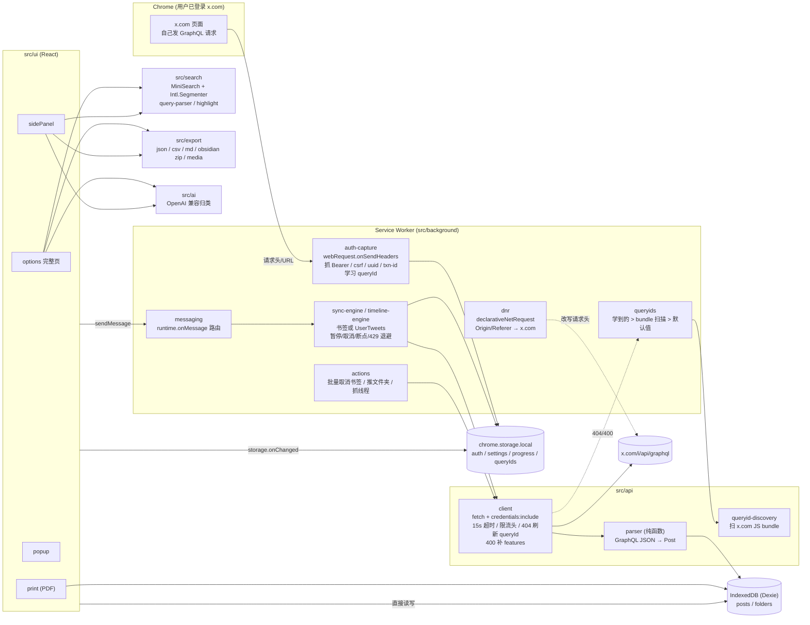

# Bookmark Keeper — X (Twitter) 书签管家 (Chrome MV3 扩展)

**当前版本: 0.4.4** — 列表与书签（搜索）页统一「删除书签」主操作文案（批量/单条），卡片也有删除入口；流程仍走 X DeleteBookmark。

把你在 X 上的**书签**与指定账号的**公开发帖**(UserTweets)同步到本地 IndexedDB，提供中英文全文搜索、文件夹/标签管理、批量操作、导出和可选的 AI 自动归类。

灵感来自 twillot 的书签/时间线思路（只借鉴整体架构与端点名称，**代码全部重新编写**，不含 twillot 的名称/图标/域名，也没有复制其 MPL-2.0 源文件）。不做发推、点赞、关注、授权/付费墙/多账号。

<details>
<summary><strong>English summary</strong></summary>

Chrome MV3 extension that syncs your X (Twitter) **bookmarks** and optional public **UserTweets** timelines into local IndexedDB. v0.4.4 clarifies Delete bookmark on Library + Search (bulk/row/card); same DeleteBookmark flow. v0.4.3 added Library list bulk/single unbookmark. v0.4.2 adds Settings LLM model select (common OpenAI-compatible ids + custom). v0.4.1 added light/dark theme toggle (default dark). v0.4 added an X-style library table (column toggles, filter/export panels, paginated Dexie reads). Also: Chinese/English full-text search (MiniSearch + `Intl.Segmenter`), folders/tags, bulk actions, batched export (JSON/CSV/Markdown/Obsidian), optional OpenAI-compatible AI classification. Auth is captured from your logged-in x.com tab (no official paid API). Inspired by twillot’s architecture ideas only — fully rewritten. **Not verified against real X accounts** in this repo; unit tests + Mock-X e2e only. May violate X ToS; use at your own risk. MIT License.

Step-by-step: [docs/USAGE.md](./docs/USAGE.md) · Develop: [docs/DEVELOPMENT.md](./docs/DEVELOPMENT.md) · Contribute: [CONTRIBUTING.md](./CONTRIBUTING.md)

</details>

> ## ⚠️ 重要声明：未对真实 X 账号实测
>
> 开发环境无法登录 X，因此**从未对真实 X 接口、真实账号做过验证**。接口形状、默认 queryId、features 开关均来自公开资料和对 twillot 公开思路的阅读，可能已经过期。
>
> 已做的验证仅限：
>
> 1. 用手工构造的 fixture 做的单元测试（解析器、搜索、导出、同步引擎、HTTP 客户端等，`npm test`）；
> 2. `npm run e2e`：真实 Chrome 加载 `dist/` + **本地 Mock X 服务**（自签名 HTTPS，`--host-resolver-rules` 把 x.com 映射到本机），冒烟验证扩展自身流水线（凭证捕获、queryId 刷新、分页、429 退避、DNR 改写 Origin、UI 搜索等）。这证明「扩展代码按预期工作」，**不证明真实 X 会接受这些请求**。

**文档导航**

| 文档 | 内容 |
| --- | --- |
| [docs/USAGE.md](./docs/USAGE.md) | 逐步使用指南（安装、首次同步、发帖同步、搜索、导出、设置） |
| [docs/DEVELOPMENT.md](./docs/DEVELOPMENT.md) | 开发命令、目录、架构落点、e2e |
| [CONTRIBUTING.md](./CONTRIBUTING.md) | 贡献流程 |
| [LICENSE](./LICENSE) | MIT |

---

## 功能

| 功能 | 状态 |
| --- | --- |
| 全量 / 增量同步、断点续传、进度、暂停 / 继续 / 取消 | ✅ 单测 + Mock e2e |
| 按 @handle / 主页链接同步公开发帖 (UserTweets + cursor 翻页) | ✅ 单测；真实接口未验证 |
| 一键同步「我发过的全部帖子」（会话解析 screen_name → UserTweets） | ✅ 单测；真实接口未验证 |
| 发帖与书签分区（`source: timeline\|bookmark`，文件夹 `timeline:@handle`） | ✅ |
| 全量同步报告（内容分布 + Top 作者；完成后自动弹出，也可在「同步」页打开） | ✅ 单测 |
| X 风格深色/浅色主题（可切换，默认深色；设置页 + 列表工具栏） | ✅ |
| 书签列表页：表格列（#/用户/文件夹/帖子/媒体/浏览/转发/喜欢/回复/时间）、列显示开关与重置 | ✅ |
| 列表页筛选面板（日期快捷范围、最旧优先、文件夹/内容/帖子类型/@用户/可用性） | ✅ |
| 列表页导出面板（帖子|媒体、全部/已选、CSV/JSON/Markdown/PDF、自定义文件名；走现有 export/batch） | ✅ |
| 列表 Dexie/搜索分页（默认 50 行/页），不整库载入 | ✅ |
| 同步 X 书签文件夹（BookmarkFoldersSlice + BookmarkFolderTimeline） | ✅ 单测 + Mock e2e |
| 本地自建文件夹、重命名、删除、手动移动（可选推送到 X，实验性） | ✅ 本地逻辑已测；**推送到 X 未验证** |
| 保留已删除推文 / 已取消的书签（`status`: `active` / `tweet_deleted` / `unbookmarked`） | ✅ 单测 + e2e |
| 全文搜索（MiniSearch + `Intl.Segmenter('zh')`、前缀/模糊、相关性排序、高亮、分页） | ✅ 单测 + e2e |
| 查询语法 `from: since: until: folder: has:image/video/link/quote tag: is: source: "短语" -排除` | ✅ 单测 |
| 过滤面板（作者/日期/文件夹/媒体/标签/状态）+ 多种排序 | ✅ 手动构造 + e2e 部分 |
| 标签增删改（单条编辑、批量加/去、全局重命名/删除） | ✅ 单测 |
| 批量取消 X 书签（DeleteBookmark，默认二次确认，可选同时删本地） | ✅ Mock e2e；**真实接口未验证** |
| 导出 JSON / CSV（带 BOM）/ Markdown（单文件）/ Obsidian（zip，每条带 frontmatter 的 .md） | ✅ 单测 |
| 分批导出（默认每批 1000，可配置；优先一个总 zip 内含多批文件，每 10 批再拆 zip） | ✅ 单测 |
| PDF：打印友好页 + `window.print()`（另存为 PDF） | ⚠️ 已实现，未做自动化验证 |
| 媒体批量下载（`chrome.downloads`，图片取 `:orig`，视频取较高码率 mp4） | ⚠️ 文件名/URL 生成有单测；实际下载未验证 |
| AI 自动归类（OpenAI 兼容 endpoint + Key；分批限速；预览后再应用；无 Key 隐藏入口） | ✅ 提示词/解析/分批单测；**未对真实 LLM 实测** |
| 线程抓取（TweetDetail，同作者自回复链；同步时可选开关，也可对选中项手动抓取） | ✅ 单测 + Mock e2e；真实响应结构未验证 |
| 设置页：主题、同步选项、页间延迟、中/英语言、LLM 配置、备份导入导出、清空数据 | ✅ |
| 侧边栏（sidePanel）+ popup + options 完整页 | ✅ 渲染冒烟 |

---

## 安装

### 方式一：从源码构建

```bash
git clone <仓库 URL>   # 由维护者提供
cd bookmark-keeper
npm install
npm run build          # 类型检查 + 构建到 dist/
npm test               # 建议先跑通单元测试
```

1. 打开 `chrome://extensions`，开启右上角「开发者模式」；
2. 点击「加载已解压的扩展程序」，选择本项目的 **`dist/`** 目录（不是仓库根目录）；
3. 按下一节完成首次使用。

源码仓默认**不提交** `dist/`（见 `.gitignore`）。日常开发可用 `npm run dev`（`vite build --watch`），改完在扩展页点「重新加载」。

### 方式二：直接加载发布包中的 `dist/`

若你通过 **GitHub Releases**（或作者提供的 `bookmark-keeper.zip`）获得构建产物：

1. 解压 zip，确认内含 `dist/manifest.json`；
2. 同样在开发者模式下「加载已解压的扩展程序」→ 选择其中的 **`dist/`**。

### Releases 思路（维护者）

- **Git 仓库**：只提交源码与文档，忽略 `node_modules/`、`dist/`、`*.zip`、`.env*`。
- **GitHub Releases**：打 tag（如 `v0.2.0`）时附带 zip，内含源码 + 已构建的 `dist/`（仍排除 `node_modules`），方便用户免 Node 环境加载。
- 本仓库可用 `zip` 脚本或 CI 生成该产物；本地亦可参考文末「打包」说明。

可选：`npm run e2e` 需要本机 Chrome（`CHROME_BIN` 可指定路径）和 `openssl`，会启动本地 Mock X 做冒烟测试。

---

## 首次使用

1. **在同一 Chrome 配置中登录** <https://x.com>；
2. 打开 <https://x.com/i/bookmarks> 并**刷新一次**，让扩展从页面自己的 GraphQL 请求中捕获 Bearer / csrf / uuid / txn-id，并学习 queryId（**切勿**手动复制 cookie/token 到任何地方）；
3. 点击扩展图标打开 popup，或打开侧边栏 / 选项页 → **同步**；
4. 先点 **增量同步** 试跑；需要完整库与「已取消书签」检测时再用 **全量同步**（会有确认提示）。

详细逐步说明（含排错）：[docs/USAGE.md](./docs/USAGE.md)。

---

## 发帖同步（handle / 我的发帖）

在同步页的「公开发帖」面板：

- 输入 `@handle` 或 `https://x.com/xxx` → **同步此账号**（UserTweets + cursor 翻页）；
- 或点 **同步我的发帖**（从当前会话解析 screen_name 再拉 UserTweets）。

写入本地时 `source: timeline`，文件夹为 `timeline:@handle`，与书签分区；搜索可用 `source:timeline` / `folder:timeline:@handle`。若同 `tweet_id` 已是书签则不降级。

**强烈建议**：页间延迟调大（如 3–8 秒）、先少量试跑、不要并行多开。连续翻页极易限流，极端情况下有账号风险。接口形状未经真实验证。

---

## 搜索语法

词间默认 AND。示例：

| 语法 | 示例 |
| --- | --- |
| 关键词 / 短语 / 排除 | `rust async` · `"精确短语"` · `-广告` |
| 作者 | `from:alice` |
| 日期 | `since:2024-01-01` `until:2024-06-30`（亦支持 `YYYY-MM` / `YYYY`） |
| 文件夹 | `folder:"My Folder"` · `folder:none` |
| 媒体等 | `has:image` `has:video` `has:link` `has:quote` `has:media` |
| 标签 / 状态 / 来源 | `tag:todo` · `is:active\|deleted\|unbookmarked` · `source:bookmark\|timeline` |

过滤面板与语法取 AND；排序可选相关性 / 收藏时间 / 发布时间 / 点赞 / 浏览量等。

---

## 分批导出

大数据量时请勿指望「一次导出整库到单个巨大文件」：

- 书签页导出菜单：**分批导出当前结果 / 全库**（JSON / CSV / Markdown / Obsidian）；
- 批次大小在工具栏或**设置 → 导出每批条数**配置（默认 **1000**，约 100–10000）；
- 优先打成**一个总 zip**（内含 `bookmarks_001_of_059_00001-01000.json` 等及 `.meta.json`）；超过约 10 批再拆多个 zip；
- 过程显示「正在导出第 x/y 批」。

另支持单次：JSON / CSV / Markdown / Obsidian zip / 打印 PDF / 媒体下载。设置页「备份导出」仍会读全库，大库请等待完成。

---

## 设置

选项页可配置：

- 是否同步 X 书签文件夹、是否标记已删除/已取消、同步时抓线程、实验性「推文件夹到 X」、批量取消二次确认；
- 页间延迟 min/max、每页条数、导出批次、界面中/英；
- LLM：OpenAI 兼容 endpoint、API Key（仅存本机 `chrome.storage.local`）、模型、批次与间隔；无 Key 不显示 AI 入口；保存时可能申请该域名可选权限；
- 备份导入 / 导出、清空本地数据。

---

## 大数据量说明

此前侧边栏/书签库在约 5–6 万条时会卡住：根因是打开 UI 时 `getAllPosts()`（`db.posts.toArray()`）整库入内存再同步建 MiniSearch。

**当前策略：**

1. **打开即显**：只读 count、文件夹/标签名；列表 Dexie 索引分页（默认每页约 40）；缩略图 `loading="lazy"`。
2. **空查询/仅过滤**：`orderBy` + `offset/limit`，或先用索引缩小范围。
3. **全文搜索**：优先加载 IndexedDB 中持久化的 MiniSearch；否则后台分批建索引并显示进度，浏览不阻塞。
4. **同步中**：`dbVersion` 触发的 reload 节流，避免反复全量重建。
5. **文件夹/标签 count**：`where(...).count()` / `uniqueKeys()`，避免全表 `toArray`。
6. **分批导出**：见上一节。

### 升级

1. `npm run build`（或使用发布 zip 内 `dist/`）；
2. `chrome://extensions` → 「重新加载」；
3. 库名 `bookmark-keeper` 不变则 **IndexedDB 保留**（如 schema v3 增加 `source`；旧书签缺省为 `bookmark`）。一般无需重新全量同步。

### 已知限制

- 索引未建完前关键字搜索可能走分批子串扫描，首次较慢；
- 「选择全部结果」在超大匹配集上以当前页为主，避免一次勾选数万 id；请用分批导出；
- 备份导出仍读全库；持久化 MiniSearch 占额外空间，清空数据时一并清除。

---

## 架构



### 关键设计

- **鉴权**：不用 X 官方付费 API。`webRequest.onSendHeaders` 监听 x.com 页面自己发出的 `/i/api/graphql/*`（忽略扩展自己的请求），抓取 `authorization`、`x-csrf-token`、`x-client-uuid`、`x-client-transaction-id` 存 `chrome.storage.local`；后续 `fetch(..., { credentials: 'include' })` 带 cookie，并附 `X-Twitter-Auth-Type: OAuth2Session`、`X-Twitter-Active-User: yes`。`declarativeNetRequest` 仅对「扩展发起 → x.com/i/api/」改写 `Origin`/`Referer` 为 `https://x.com`。
- **queryId 失效兜底**：页面学习优先；404/400（unknown query）时从书签页 HTML → `abs.twimg.com` JS bundle 扫描 `queryId`+operationName，更新后重试；仍失败报 `query_id`。同步页可手动「重新扫描」。默认值写在 `src/api/endpoints.ts`。
- **features 兜底**：400 且报 `features cannot be null: a, b` 时自动补 `false` 并记住。
- **分页与断点**：解析 `TimelineAddEntries` 的 Bottom cursor；游标写入进度，取消/出错/SW 回收后可同 `run_id` 续传。增量同步遇到已存在且 active 的书签后，本页处理完即停。
- **限流**：读 `X-Rate-Limit-*`；429 按 Reset 等待（期间保活 + `chrome.alarms`）；页间随机延迟可配；403/401 视为鉴权问题；15s 超时，网络错误退避重试。
- **保留已删除**：tombstone → `tweet_deleted`；**仅完整全量成功结束后**，本次未见的 active → `unbookmarked`（抓取数异常偏少则跳过标记）。本地不丢弃；再现则恢复 `active`。
- **存储**：Dexie `posts` / `folders` / `searchMeta`；schema v3 增加 `source`（`bookmark`|`timeline`）。
- **搜索**：打开 UI **不再**全库 `toArray()`；空查询索引分页；有关键字时优先持久化 MiniSearch，否则 idle 分批建索引。
- **多入口构建**：手写 manifest + Vite（background → `background.js`；四个 HTML 入口）。不依赖 crxjs。

更细的目录说明见 [docs/DEVELOPMENT.md](./docs/DEVELOPMENT.md)。

---

## 风险与免责

1. **X 内部接口随时变动**：`/i/api/graphql/*` 非公开；queryId、features、响应结构都会变 → 404 / 400 /「无法识别响应结构」。
2. **queryId 失效**：① 打开书签页并刷新；② 同步页「从 x.com 脚本重新扫描」；③ 仍不行则更新 `DEFAULT_QUERY_IDS` 并重新构建。
3. **`x-client-transaction-id` 重放**：扩展复用最近捕获值，将来可能被拒绝（403/400）。
4. **服务条款与账号风险**：自动化访问内部接口**可能违反 X ToS**，存在限流、临时锁定或账号受限风险。请自行评估；保持默认或更大延迟，避免频繁全量与多处并行同步。
5. **文件夹推送、批量取消书签**等 mutation 未经真实验证；取消 X 端书签不可撤销（本地默认仍保留记录）。
6. Chrome 回收 service worker 时，进行中同步会标为暂停，可「继续」断点恢复。
7. 数据存本机 IndexedDB；清浏览器数据/卸载扩展会丢失，请定期「备份导出」。
8. **UserTweets 翻页账号风险**：连续请求极易限流，极端情况下锁号/封号。调大延迟、用小号、先试几页；与书签同步共用鉴权会话。
9. **UserByScreenName / account/settings**：解析 handle 与当前账号依赖未公开/半公开接口，形状可能变化。

**免责声明**：本软件按「现状」提供，作者与贡献者不对账号处罚、数据丢失、接口失效或任何间接损失负责。使用即表示你已阅读并自行承担风险。

---

## 与 twillot 的差异

| 项目 | twillot | Bookmark Keeper |
| --- | --- | --- |
| 范围 | 书签 + 自己的 post/likes/following、发布、授权/付费 | **书签 + 可选 UserTweets 公开发帖**；无授权/付费墙/多账号 |
| 搜索 | 子串匹配 | MiniSearch + `Intl.Segmenter('zh')`、相关性、前缀/模糊、查询语法、高亮 |
| 构建/UI | 自有 monorepo | Vite 多入口 + 手写 manifest，React，sidePanel + options + popup |
| queryId | 写死 | 页面学习 + bundle 扫描 + 默认值三级兜底，404/400 自动恢复 |
| 同步 | — | 断点续传、暂停/取消、429 按 Reset 退避、已取消/已删除标记保留 |
| 导出 | — | JSON/CSV/Markdown/Obsidian zip / 打印 PDF / 媒体下载 / **分批导出** |
| AI | — | 自配 OpenAI 兼容 LLM 归类，预览确认后应用 |
| 测试 | — | vitest 单测 + Mock X 端到端冒烟 |
| 代码 / 许可 | MPL-2.0 | **全部重写**；本项目 **MIT** |

---

## 开发

```bash
npm install
npm run typecheck
npm test
npm run build        # → dist/
npm run dev          # vite build --watch
npm run e2e          # 需先 build；本机 Chrome + openssl
```

详见 [docs/DEVELOPMENT.md](./docs/DEVELOPMENT.md) 与 [CONTRIBUTING.md](./CONTRIBUTING.md)。

**请勿**在仓库、Issue、测试夹具中提交真实 cookie、token、API Key 或个人书签数据。

---

## 许可证

[MIT](./LICENSE) — Copyright (c) 2026 Bookmark Keeper contributors / applepiemj。
