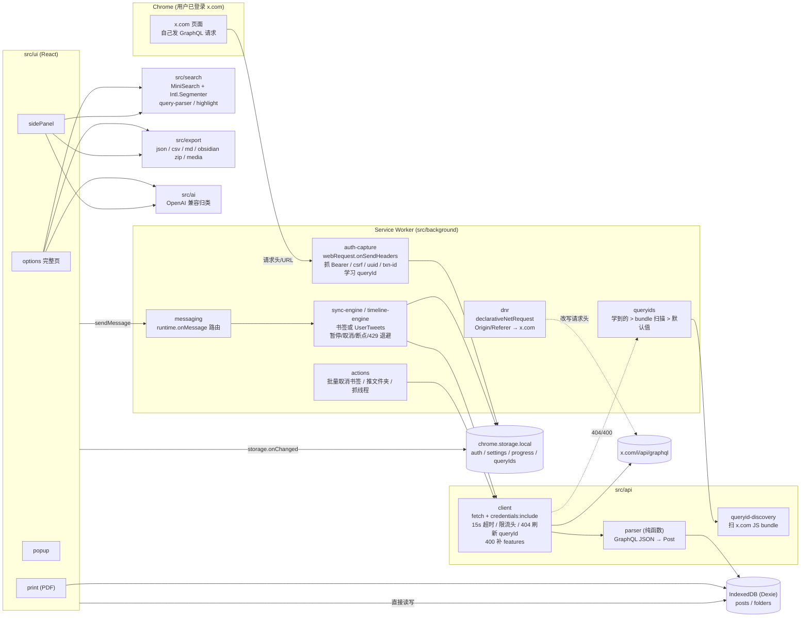

# X Toolkit — X (Twitter) 书签管家 + 打击账本 (Chrome MV3 扩展)

**当前版本: 0.7.4** — 一个扩展同时包含书签库与打击账本 / Strike Ledger。本产品此前名为 Bookmark Keeper；本地书签库 IndexedDB 名仍是 `bookmark-keeper`，旧库可直接升级。0.7.1 给打击账本加上静音/屏蔽队列和限流面板。0.7.2 可以编辑关键词包（含文本导入导出），并从帖子把选中的词加进词库；命中只出黄标，不自动记一笔。0.7.3 在可选 BYOK 建议为垃圾或营销时，经你确认后把抽出的短词写入一个词库；仍然不自动记一笔。0.7.4 在时间线上用保护徽章和标签芯片标出已关注/白名单账号，以及已有的打击次数；点芯片只打开标记，不会自动静音或屏蔽。

在 x.com 时间线上标记垃圾/营销的账本与书签同步共用一个工具栏图标。请卸载单独安装的 X Strike Ledger，否则两个内容脚本会同时注入。

把你在 X 上的**书签**与指定账号的**公开发帖**(UserTweets)同步到本地 IndexedDB，提供中英文全文搜索、文件夹/标签管理、批量操作、导出和可选的 AI 自动归类。

灵感来自 twillot 的书签/时间线思路（只借鉴整体架构与端点名称，**代码全部重新编写**，不含 twillot 的名称/图标/域名，也没有复制其 MPL-2.0 源文件）。不做发推、点赞、关注、授权/付费墙/多账号。

<details>
<summary><strong>English summary</strong></summary>

Chrome MV3 extension **X Toolkit**. It syncs X **bookmarks** and optional public **UserTweets** into local IndexedDB, and adds a local **Strike Ledger**: mark Spam / Marketing on the x.com timeline, then hide locally or (only if you turn it on) mute/block through X’s own menu. v0.7.1 queues mute/block (jitter of about 1s+, a daily cap, backoff, pause/resume). v0.7.2 adds editable keyword packs (including plain-text import/export) and **Add selection to keyword pack** from a tweet’s Mark menu or the right-click menu. A keyword hit still only shows the yellow Suspect chip and never adds a strike. v0.7.3 can distill one BYOK spam/marketing suggestion into short keyword rules after you confirm; that save does not add a strike and does not call the model again. v0.7.4 paints a Protected badge on accounts you follow or whitelist, and compact tag chips such as Spam×2 beside the name and in the strike row. Clicking a chip opens Mark and does not enqueue mute or block. Storage keys stay `bk_*` and `xsl` / `xslSecret`. Unload a standalone Strike Ledger install so the page is not injected twice. Mute and block stay off until you enable them. **Not verified against real X accounts** in this repo; unit tests + Mock-X e2e only. May violate X ToS; use at your own risk. MIT License.

Step-by-step: [docs/USAGE.md](./docs/USAGE.md) · Develop: [docs/DEVELOPMENT.md](./docs/DEVELOPMENT.md) · Contribute: [CONTRIBUTING.md](./CONTRIBUTING.md)

</details>

> ## ⚠️ 重要声明：未对真实 X 账号实测
>
> 开发环境无法登录 X，因此**从未对真实 X 接口、真实账号做过验证**。接口形状、默认 queryId、features 开关均来自公开资料和对 twillot 公开思路的阅读，可能已经过期。
>
> 已做的验证仅限：
>
> 1. 用手工构造的 fixture 做的单元测试（解析器、搜索、导出、同步引擎、HTTP 客户端等，`npm test`）；
> 2. `npm run e2e`：真实 Chrome 加载 `dist/` + **本地 Mock X 服务**（自签名 HTTPS，`--host-resolver-rules` 把 x.com 映射到本机），冒烟验证扩展自身流水线（凭证捕获、queryId 刷新、分页、429 退避、DNR 改写 Origin、UI 搜索等）。这证明「扩展代码按预期工作」，**不证明真实 X 会接受这些请求**。

**文档导航**

| 文档 | 内容 |
| --- | --- |
| [docs/USAGE.md](./docs/USAGE.md) | 逐步使用指南（安装、首次同步、发帖同步、搜索、导出、设置） |
| [docs/DEVELOPMENT.md](./docs/DEVELOPMENT.md) | 开发命令、目录、架构落点、e2e |
| [CONTRIBUTING.md](./CONTRIBUTING.md) | 贡献流程 |
| [LICENSE](./LICENSE) | MIT |

---

## 功能

| 功能 | 状态 |
| --- | --- |
| 全量 / 增量同步、断点续传、进度、暂停 / 继续 / 取消 | ✅ 单测 + Mock e2e |
| 按 @handle / 主页链接同步公开发帖 (UserTweets + cursor 翻页) | ✅ 单测；真实接口未验证 |
| 一键同步「我发过的全部帖子」（会话解析 screen_name → UserTweets） | ✅ 单测；真实接口未验证 |
| 发帖与书签分区（`source: timeline\|bookmark`，文件夹 `timeline:@handle`） | ✅ |
| 全量同步报告（内容分布 + Top 作者；完成后自动弹出，也可在「同步」页打开） | ✅ 单测 |
| X 风格深色/浅色主题（可切换，默认深色；设置页 + 列表工具栏） | ✅ |
| 书签列表页：表格列（#/用户/文件夹/帖子/媒体/浏览/转发/喜欢/回复/时间）、列显示开关与重置 | ✅ |
| 列表页筛选面板（日期快捷范围、最旧优先、文件夹/内容/帖子类型/@用户/可用性） | ✅ |
| 列表页导出面板（帖子|媒体、全部/已选、CSV/JSON/Markdown/PDF、自定义文件名；走现有 export/batch） | ✅ |
| 列表 Dexie/搜索分页（默认 50 行/页），不整库载入 | ✅ |
| 同步 X 书签文件夹（BookmarkFoldersSlice + BookmarkFolderTimeline） | ✅ 单测 + Mock e2e |
| 本地自建文件夹、重命名、删除、手动移动（可选推送到 X，实验性） | ✅ 本地逻辑已测；**推送到 X 未验证** |
| 保留已删除推文 / 已取消的书签（`status`: `active` / `tweet_deleted` / `unbookmarked`） | ✅ 单测 + e2e |
| 全文搜索（MiniSearch + `Intl.Segmenter('zh')`、前缀/模糊、相关性排序、高亮、分页） | ✅ 单测 + e2e |
| 查询语法 `from: since: until: folder: has:image/video/link/quote tag: is: source: "短语" -排除` | ✅ 单测 |
| 过滤面板（作者/日期/文件夹/媒体/标签/状态）+ 多种排序 | ✅ 手动构造 + e2e 部分 |
| 标签增删改（单条编辑、批量加/去、全局重命名/删除） | ✅ 单测 |
| 批量取消 X 书签（DeleteBookmark，默认二次确认，可选同时删本地） | ✅ Mock e2e；**真实接口未验证** |
| 导出 JSON / CSV（带 BOM）/ Markdown（单文件）/ Obsidian（zip，每条带 frontmatter 的 .md） | ✅ 单测 |
| 分批导出（默认每批 1000，可配置；优先一个总 zip 内含多批文件，每 10 批再拆 zip） | ✅ 单测 |
| PDF：打印友好页 + `window.print()`（另存为 PDF） | ⚠️ 已实现，未做自动化验证 |
| 媒体批量下载（`chrome.downloads`，图片取 `:orig`，视频取较高码率 mp4） | ⚠️ 文件名/URL 生成有单测；实际下载未验证 |
| AI 自动归类（OpenAI 兼容 endpoint + Key；分批限速；预览后再应用；无 Key 隐藏入口） | ✅ 提示词/解析/分批单测；**未对真实 LLM 实测** |
| 线程抓取（TweetDetail，同作者自回复链；同步时可选开关，也可对选中项手动抓取） | ✅ 单测 + Mock e2e；真实响应结构未验证 |
| 设置页：主题、同步选项、页间延迟、中/英语言、LLM 配置、备份导入导出、清空数据 | ✅ |
| 侧边栏（sidePanel）+ popup + options 完整页 | ✅ 渲染冒烟 |
| 多账号书签归属（v0.5）：`accounts` 记录收藏者；删除只动当前登录账号；其他账号的帖子跳过 | ✅ 单测 |
| 库视图（v0.6）：侧栏、媒体画廊、按引用原文归组、重复项（不自动删除） | ✅ 归组单测；界面随构建 |
| 打击账本 / Strike Ledger：时间线标记、本地折叠、阈值、关键词黄标、可选 BYOK；静音/屏蔽走 X 菜单且默认关闭 | ✅ 账本纯逻辑单测；**菜单点击未对真实 X 验证** |
| 静音/屏蔽队列（0.7.1）：抖动、每日上限、可识别的限流退避、暂停/继续、失败重试；打击账本页的队列面板 | ✅ 队列纯逻辑单测；**菜单点击未对真实 X 验证** |
| 关键词包（0.7.2）：启用/停用、编辑、文本导入导出；从帖子「标记」或右键把选中词加入词库；可选命中记录。命中只出黄标 | ✅ 词库纯逻辑单测；**右键菜单未对真实 X 验证** |
| AI 建议蒸馏（0.7.3）：垃圾/营销建议可经确认存为短关键词或紧规则，一次写入所选词库。不自动记一笔，不批量请求模型 | ✅ 蒸馏纯逻辑单测；**建议芯片未对真实 X / 真实 LLM 验证** |
| 保护徽章 + 标签芯片（0.7.4）：已关注/白名单在时间线上显示保护徽章；已有标签显示成「垃圾×2」。点芯片打开标记。不自动入队静音/屏蔽 | ✅ 展示模型单测；**真实时间线注入未验证** |

---

## 安装

### 方式一：从源码构建

```bash
git clone <仓库 URL>   # 由维护者提供
cd bookmark-keeper
npm install
npm run build          # 类型检查 + 构建到 dist/
npm test               # 建议先跑通单元测试
```

1. 打开 `chrome://extensions`，开启右上角「开发者模式」；
2. 点击「加载已解压的扩展程序」，选择本项目的 **`dist/`** 目录（不是仓库根目录）；
3. 按下一节完成首次使用。

源码仓默认**不提交** `dist/`（见 `.gitignore`）。日常开发可用 `npm run dev`（`vite build --watch`），改完在扩展页点「重新加载」。

### 方式二：直接加载发布包中的 `dist/`

若你通过 **GitHub Releases**（或作者提供的 `bookmark-keeper.zip`）获得构建产物：

1. 解压 zip，确认内含 `dist/manifest.json`；
2. 同样在开发者模式下「加载已解压的扩展程序」→ 选择其中的 **`dist/`**。

### Releases 思路（维护者）

- **Git 仓库**：只提交源码与文档，忽略 `node_modules/`、`dist/`、`*.zip`、`.env*`。
- **GitHub Releases**：打 tag（如 `v0.2.0`）时附带 zip，内含源码 + 已构建的 `dist/`（仍排除 `node_modules`），方便用户免 Node 环境加载。
- 本仓库可用 `zip` 脚本或 CI 生成该产物；本地亦可参考文末「打包」说明。

可选：`npm run e2e` 需要本机 Chrome（`CHROME_BIN` 可指定路径）和 `openssl`，会启动本地 Mock X 做冒烟测试。

---

## 打击账本 / Strike Ledger

安装这一个扩展即可。如果还加载着独立的 X Strike Ledger，先在 `chrome://extensions` 里移除或停用它，避免同一条帖子出现两套「标记」按钮。

打开 x.com / twitter.com / mobile.x.com 的时间线，每条帖子下方有 **标记**（Shadow DOM）。计数只在你确认之后增加；关键词和 AI 只会给黄标，不会自己记账。数据在 `chrome.storage.local` 的 `xsl`，API key 在单独的 `xslSecret`，不会写进书签 IndexedDB，也和书签设置里的 LLM key 分开。

选项页侧栏 **打击账本** 可以改阈值、确认/自动/仅提示、快捷键、关键词包、导入导出。Popup 只有一个，里面有进入账本设置的入口。

静音和屏蔽 **默认关闭**。打开「允许通过 X 的菜单执行静音/屏蔽」后，扩展会去点帖子上 X 自己的「更多」菜单再点 Mute/Block。这是在替你操作网页，不是官方 API，也 **没有** 接到本扩展的 GraphQL DeleteBookmark / 凭证捕获路径。页面改版可能点不到；失败会留在队列里重试。不要用自动模式配合屏蔽做批量封禁。本地折叠不访问 X。

### 在时间线上试静音/屏蔽队列

达到阈值，或你在「标记」面板里点「排队静音 / 排队屏蔽」时，动作只进入本地队列，不会在页面上连点。打开的时间线每次只处理一条能看见的账号：间隔不少于设置值，再加约 1–2.5 秒抖动；有每日上限；若页面上出现能识别的限流提示（例如 429）会退避。选项页 **打击账本 → 队列与限流** 显示队列长度、失败项、最近错误、今日已用/上限，并可暂停、继续、重试失败项、清空等待或失败项。

自动 / 确认 / 仅提示仍然有效。白名单和你关注的账号不会被自动入队；关注状态未知时也不会自动静音或屏蔽。仅提示只出通知。仍只点 X 自己的菜单。

1. 重新构建并加载 `dist/`。选项页打开「允许通过 X 的菜单执行静音/屏蔽」，每日上限可先设小（例如 3）。模式用 **确认** 更稳妥。
2. 打开 x.com 时间线，对一个你没有关注、且不在白名单的账号点「标记」→「排队静音」。也可以把垃圾标记到阈值，在确认框里勾选静音或屏蔽。
3. 留在能看到该账号帖子的时间线。扩展会按队列去点 X 的「更多」菜单，而不是把队列一次点完。
4. 回到 **队列与限流** 看长度、失败和今日用量。可暂停后再继续。失败项可以单条或整批重试。

书签同步里的 “timeline” 是 UserTweets 抓取；打击账本里的时间线是页面上的标记/折叠。两套消息类型分开（书签是 `timeline/start` 这类，账本是 `MARK` / `SET_HIDDEN` 这类）。

### 从一条帖子把词加入关键词包（0.7.2）

关键词命中**只**在帖子上显示黄色 **Suspect / 可疑**。它不会给账号加打击次数。要记账，仍需你在「标记」里自己确认。

**用「标记」菜单（推荐）：**

1. 重新构建并加载 `dist/`（版本 0.7.2）。
2. 打开 x.com 时间线，在某条帖子正文里用鼠标选中一个词或短语。
3. 点这条帖子上的 **标记**。
4. 面板下方会带上选中的文字。选一个关键词包，点 **加入此包**。没选中文字时，也可以在同一个输入框里自己打一个词。
5. 这个词按「正文」保存（不会当成正则）。之后别的帖子正文再出现它，才会出黄标。重复添加会提示已经在包里。

**用右键（Chrome MV3 的 contextMenus，仅在 x.com / twitter.com 的选中文字上出现）：**

1. 选中帖子里的文字，右键。这依赖 manifest 里的 `contextMenus` 权限；重新加载扩展后即可使用。
2. 选 **把选中文字加入关键词包**（英文界面是 **Add selection to keyword pack**）。
3. 再选要放进的词库。停用的包会标成「已停用」，仍可以加入，但停用期间不会出黄标。

选项页 **打击账本 → 关键词包** 可以启用/停用每个包、改名称和建议标签、逐条改规则。下面的 **词库文本** 用纯文本编辑整套词库：`[包名]` 开头，接着可选 `id:` / `enabled:` / `suggest:`，然后每行一条。没有 `[包名]` 的纯词表会导入成一个名为 `Imported` 的包。点 **应用文本** 只更新表单，再点 **保存** 才写入。**导出文本** / **导入文本** 走 `.txt`。

**命中记录**默认关闭。打开「记录关键词命中（调试）」后，黄标会在本机留下最多 40 条短记录（词、包、账号、摘要），便于看规则为什么响。可以清空。这条记录**不会**增加打击次数。

### 把一条 AI 建议蒸馏进关键词包（0.7.3）

AI 建议默认关闭。密钥仍只在 `xslSecret`，不进词库，也不进书签库的 LLM 设置。蒸馏不会自己记一笔，也不会把时间线上的帖子批量发给模型。

1. 重新构建并加载 `dist/`（版本 0.7.3）。选项页 **打击账本 → AI 建议** 打开「启用 BYOK 建议」，填写端点、模型和 API key，然后保存。不打开时，时间线上没有「让 AI 看一看」。
2. 打开 x.com 上的一条帖子。点 **让 AI 看一看**。同一条帖子的正文、简介和用户名会先按内容哈希查本地缓存；命中缓存就不会再请求。自动询问只在你另外打开「只对黄标可疑帖自动询问」时，对已经是黄标的那一条生效，仍然一条一条来。
3. 若芯片变成 **AI 建议垃圾** 或 **AI 建议营销**，点它。面板列出从这条建议抽出的短规则：模型原文里出现、并且帖子里确实有的短语；原因里用引号标出、并且帖子里有的片段；短链、`微信:` 一类联系方式、`日入`+金额、`dm me` 这类紧规则。没有抽出短词时，面板不显示保存按钮。
4. 选一个关键词包（会优先选已启用、且建议标签与这次判断一致的包）。点 **存为关键词**。勾选的规则一次写入该包。这一下**不**记打击。
5. **确认记一笔** 仍是旁边单独的按钮。只有点它才会给这个账号加一次垃圾或营销。保存关键词不会顺手点它。
6. 之后别的帖子若命中这些词，只出黄色 **可疑**。要记账，仍需你自己确认。

「认为不像」的结果没有可保存的规则。关掉 AI 或清掉 key 之后，不会再发起新的建议请求。

### 时间线上的保护徽章和标签芯片（0.7.4）

已关注的账号，以及你放进白名单的账号，本来就不会被自动静音或屏蔽。0.7.4 把这件事画在帖子上，并把这个账号已经有的标签次数直接显示出来，不用先点「标记」。

一条普通帖子在 x.com 时间线上大致是这样（英文界面把「已关注保护」写成 **Protected**，白名单同样是 **Protected**）：

```text
显示名
@handle · 时间
[已关注保护]  [垃圾×2]  [营销×1]
正文……
[标记]  [已关注保护]  [垃圾×2]  [营销×1]  [可疑]
```

- **名字下方一行**（Shadow DOM，插在 X 的用户名区块后面，不塞进会被截断的名字链接里）：绿色徽章。你正在关注时是 **已关注保护**；只有白名单、页面上又能看出未关注时是 **白名单保护**。两者都有时仍显示 **已关注保护**，悬停说明两者都不会自动入队。同一行接着紧凑芯片，例如 **垃圾×2**、**营销×1**。内置标签在前，其余按次数从高到低，最多 4 个，多出来的是 **+N**。
- **帖子动作栏**（原来的「标记」那一行，同样是 Shadow DOM）：先是 **标记**，然后同一枚保护徽章和同样的芯片，再是原来的黄标 **可疑** 和 AI 芯片。折叠后的占位条也会带上徽章和 `垃圾×2` 这种计数。
- **点芯片**会打开原来的标记面板，不会记一笔，也不会把静音/屏蔽放进队列。保护徽章本身不是按钮。面板顶部用绿色字重复「不会自动入队」。关注状态以页面上这次看到的为准；看不到关注按钮、又不在白名单时，不显示保护徽章（自动静音本来也会跳过未知状态）。
- 时间线重绘把注入节点拿掉时，扫描会把 Shadow host 挂回去。挂不上用户名区块时，动作栏里仍然有徽章和芯片。

重新构建并加载 `dist/`（版本 0.7.4）后，打开 x.com 时间线即可看到。这条注入**没有**在真实 X 账号上验证过。

---

## 首次使用

1. **在同一 Chrome 配置中登录** <https://x.com>；
2. 打开 <https://x.com/i/bookmarks> 并**刷新一次**，让扩展从页面自己的 GraphQL 请求中捕获 Bearer / csrf / uuid / txn-id，并学习 queryId（**切勿**手动复制 cookie/token 到任何地方）；
3. 点击扩展图标打开 popup，或打开侧边栏 / 选项页 → **同步**；
4. 先点 **增量同步** 试跑；需要完整库与「已取消书签」检测时再用 **全量同步**（会有确认提示）。

详细逐步说明（含排错）：[docs/USAGE.md](./docs/USAGE.md)。

---

## 发帖同步（handle / 我的发帖）

在同步页的「公开发帖」面板：

- 输入 `@handle` 或 `https://x.com/xxx` → **同步此账号**（UserTweets + cursor 翻页）；
- 或点 **同步我的发帖**（从当前会话解析 screen_name 再拉 UserTweets）。

写入本地时 `source: timeline`，文件夹为 `timeline:@handle`，与书签分区；搜索可用 `source:timeline` / `folder:timeline:@handle`。若同 `tweet_id` 已是书签则不降级。

**强烈建议**：页间延迟调大（如 3–8 秒）、先少量试跑、不要并行多开。连续翻页极易限流，极端情况下有账号风险。接口形状未经真实验证。

---

## 搜索语法

词间默认 AND。示例：

| 语法 | 示例 |
| --- | --- |
| 关键词 / 短语 / 排除 | `rust async` · `"精确短语"` · `-广告` |
| 作者 | `from:alice` |
| 日期 | `since:2024-01-01` `until:2024-06-30`（亦支持 `YYYY-MM` / `YYYY`） |
| 文件夹 | `folder:"My Folder"` · `folder:none` |
| 媒体等 | `has:image` `has:video` `has:link` `has:quote` `has:media` |
| 标签 / 状态 / 来源 | `tag:todo` · `is:active\|deleted\|unbookmarked` · `source:bookmark\|timeline` |

过滤面板与语法取 AND；排序可选相关性 / 收藏时间 / 发布时间 / 点赞 / 浏览量等。

---

## 分批导出

大数据量时请勿指望「一次导出整库到单个巨大文件」：

- 书签页导出菜单：**分批导出当前结果 / 全库**（JSON / CSV / Markdown / Obsidian）；
- 批次大小在工具栏或**设置 → 导出每批条数**配置（默认 **1000**，约 100–10000）；
- 优先打成**一个总 zip**（内含 `bookmarks_001_of_059_00001-01000.json` 等及 `.meta.json`）；超过约 10 批再拆多个 zip；
- 过程显示「正在导出第 x/y 批」。

另支持单次：JSON / CSV / Markdown / Obsidian zip / 打印 PDF / 媒体下载。设置页「备份导出」仍会读全库，大库请等待完成。

---

## 设置

选项页可配置：

- 是否同步 X 书签文件夹、是否标记已删除/已取消、同步时抓线程、实验性「推文件夹到 X」、批量取消二次确认；
- 页间延迟 min/max、每页条数、导出批次、界面中/英；
- LLM：OpenAI 兼容 endpoint、API Key（仅存本机 `chrome.storage.local`）、模型、批次与间隔；无 Key 不显示 AI 入口；保存时可能申请该域名可选权限；
- 备份导入 / 导出、清空本地数据。

---

## 大数据量说明

此前侧边栏/书签库在约 5–6 万条时会卡住：根因是打开 UI 时 `getAllPosts()`（`db.posts.toArray()`）整库入内存再同步建 MiniSearch。

**当前策略：**

1. **打开即显**：只读 count、文件夹/标签名；列表 Dexie 索引分页（默认每页约 40）；缩略图 `loading="lazy"`。
2. **空查询/仅过滤**：`orderBy` + `offset/limit`，或先用索引缩小范围。
3. **全文搜索**：优先加载 IndexedDB 中持久化的 MiniSearch；否则后台分批建索引并显示进度，浏览不阻塞。
4. **同步中**：`dbVersion` 触发的 reload 节流，避免反复全量重建。
5. **文件夹/标签 count**：`where(...).count()` / `uniqueKeys()`，避免全表 `toArray`。
6. **分批导出**：见上一节。

### 升级

1. `npm run build`（或使用发布 zip 内 `dist/`）；
2. `chrome://extensions` → 「重新加载」；
3. 库名 `bookmark-keeper` 不变则 **IndexedDB 保留**（如 schema v3 增加 `source`；旧书签缺省为 `bookmark`）。一般无需重新全量同步。

### 已知限制

- 索引未建完前关键字搜索可能走分批子串扫描，首次较慢；
- 「选择全部结果」在超大匹配集上以当前页为主，避免一次勾选数万 id；请用分批导出；
- 备份导出仍读全库；持久化 MiniSearch 占额外空间，清空数据时一并清除。

---

## 架构



### 关键设计

- **鉴权**：不用 X 官方付费 API。`webRequest.onSendHeaders` 监听 x.com 页面自己发出的 `/i/api/graphql/*`（忽略扩展自己的请求），抓取 `authorization`、`x-csrf-token`、`x-client-uuid`、`x-client-transaction-id` 存 `chrome.storage.local`；后续 `fetch(..., { credentials: 'include' })` 带 cookie，并附 `X-Twitter-Auth-Type: OAuth2Session`、`X-Twitter-Active-User: yes`。`declarativeNetRequest` 仅对「扩展发起 → x.com/i/api/」改写 `Origin`/`Referer` 为 `https://x.com`。
- **queryId 失效兜底**：页面学习优先；404/400（unknown query）时从书签页 HTML → `abs.twimg.com` JS bundle 扫描 `queryId`+operationName，更新后重试；仍失败报 `query_id`。同步页可手动「重新扫描」。默认值写在 `src/api/endpoints.ts`。
- **features 兜底**：400 且报 `features cannot be null: a, b` 时自动补 `false` 并记住。
- **分页与断点**：解析 `TimelineAddEntries` 的 Bottom cursor；游标写入进度，取消/出错/SW 回收后可同 `run_id` 续传。增量同步遇到已存在且 active 的书签后，本页处理完即停。
- **限流**：读 `X-Rate-Limit-*`；429 按 Reset 等待（期间保活 + `chrome.alarms`）；页间随机延迟可配；403/401 视为鉴权问题；15s 超时，网络错误退避重试。
- **保留已删除**：tombstone → `tweet_deleted`；**仅完整全量成功结束后**，本次未见的 active → `unbookmarked`（抓取数异常偏少则跳过标记）。本地不丢弃；再现则恢复 `active`。
- **存储**：Dexie `posts` / `folders` / `searchMeta`；schema v3 增加 `source`（`bookmark`|`timeline`）。
- **搜索**：打开 UI **不再**全库 `toArray()`；空查询索引分页；有关键字时优先持久化 MiniSearch，否则 idle 分批建索引。
- **多入口构建**：手写 manifest + Vite（background → `background.js`；四个 HTML 入口）。不依赖 crxjs。

更细的目录说明见 [docs/DEVELOPMENT.md](./docs/DEVELOPMENT.md)。

---

## 风险与免责

1. **X 内部接口随时变动**：`/i/api/graphql/*` 非公开；queryId、features、响应结构都会变 → 404 / 400 /「无法识别响应结构」。
2. **queryId 失效**：① 打开书签页并刷新；② 同步页「从 x.com 脚本重新扫描」；③ 仍不行则更新 `DEFAULT_QUERY_IDS` 并重新构建。
3. **`x-client-transaction-id` 重放**：扩展复用最近捕获值，将来可能被拒绝（403/400）。
4. **服务条款与账号风险**：自动化访问内部接口**可能违反 X ToS**，存在限流、临时锁定或账号受限风险。请自行评估；保持默认或更大延迟，避免频繁全量与多处并行同步。
5. **文件夹推送、批量取消书签**等 mutation 未经真实验证；取消 X 端书签不可撤销（本地默认仍保留记录）。
6. Chrome 回收 service worker 时，进行中同步会标为暂停，可「继续」断点恢复。
7. 数据存本机 IndexedDB；清浏览器数据/卸载扩展会丢失，请定期「备份导出」。
8. **UserTweets 翻页账号风险**：连续请求极易限流，极端情况下锁号/封号。调大延迟、用小号、先试几页；与书签同步共用鉴权会话。
9. **UserByScreenName / account/settings**：解析 handle 与当前账号依赖未公开/半公开接口，形状可能变化。

**免责声明**：本软件按「现状」提供，作者与贡献者不对账号处罚、数据丢失、接口失效或任何间接损失负责。使用即表示你已阅读并自行承担风险。

---

## 与 twillot 的差异

| 项目 | twillot | X Toolkit |
| --- | --- | --- |
| 范围 | 书签 + 自己的 post/likes/following、发布、授权/付费 | **书签 + 可选 UserTweets 公开发帖**；无授权/付费墙/多账号 |
| 搜索 | 子串匹配 | MiniSearch + `Intl.Segmenter('zh')`、相关性、前缀/模糊、查询语法、高亮 |
| 构建/UI | 自有 monorepo | Vite 多入口 + 手写 manifest，React，sidePanel + options + popup |
| queryId | 写死 | 页面学习 + bundle 扫描 + 默认值三级兜底，404/400 自动恢复 |
| 同步 | — | 断点续传、暂停/取消、429 按 Reset 退避、已取消/已删除标记保留 |
| 导出 | — | JSON/CSV/Markdown/Obsidian zip / 打印 PDF / 媒体下载 / **分批导出** |
| AI | — | 自配 OpenAI 兼容 LLM 归类，预览确认后应用 |
| 测试 | — | vitest 单测 + Mock X 端到端冒烟 |
| 代码 / 许可 | MPL-2.0 | **全部重写**；本项目 **MIT** |

---

## 开发

```bash
npm install
npm run typecheck
npm test
npm run build        # → dist/
npm run dev          # vite build --watch
npm run e2e          # 需先 build；本机 Chrome + openssl
```

详见 [docs/DEVELOPMENT.md](./docs/DEVELOPMENT.md) 与 [CONTRIBUTING.md](./CONTRIBUTING.md)。

**请勿**在仓库、Issue、测试夹具中提交真实 cookie、token、API Key 或个人书签数据。

---

## 许可证

[MIT](./LICENSE) — Copyright (c) 2026 X Toolkit contributors / applepiemj。
